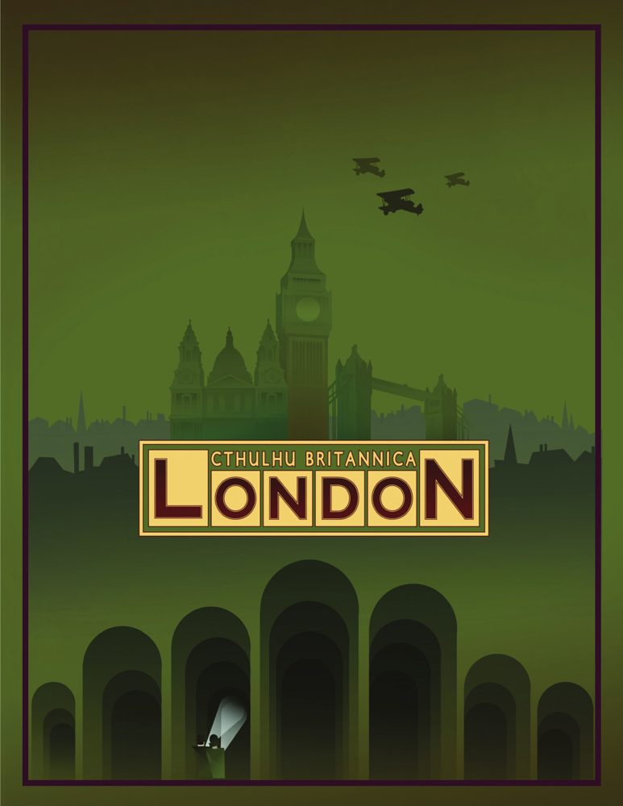

ПРИКЛЮЧЕНИЯ В МИФИЧЕСКОМ ЛОНДОНЕ

Пол Фрикер, Марк Лэтем, Питер Райт

Adventures in Mythos London (Cthulhu Britannica: London, книга 3) · Cubicle 7, 2014

*На обложке — силуэт Лондона в зелёной дымке (собор Святого Павла, Биг-Бен, Тауэрский мост), над ним бипланы; в центре — плашка «Cthulhu Britannica: London»; внизу — уходящие вглубь арки подземки и одинокая фигура с фонарём.*
