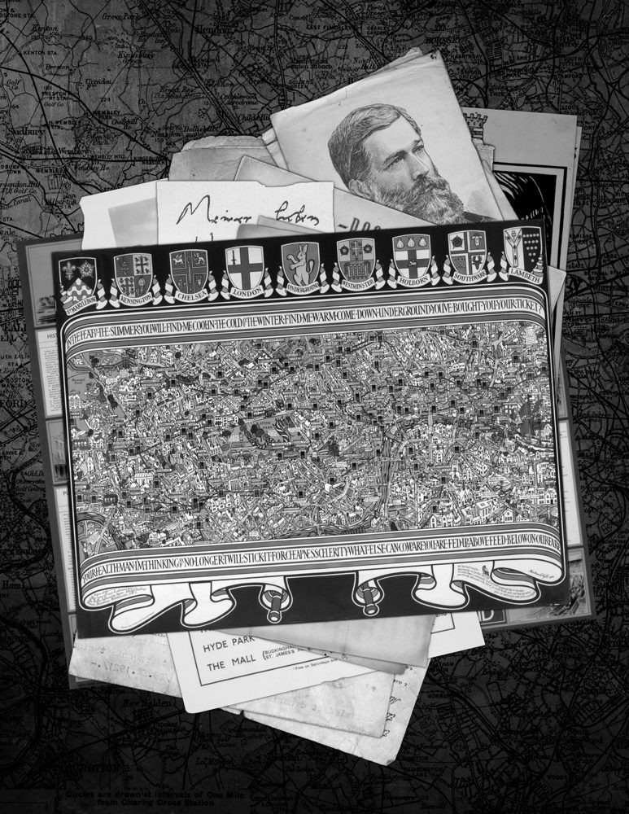

*Полностраничный коллаж: поверх старой карты Лондона, писем и газетных вырезок — рекламный плакат подземки с картой-панорамой города и гербами районов (Кенсингтон, Челси, Лондон, Вестминстер, Холборн, Саутуорк, Ламбет и др.); по краям плаката — рекламные стихи о подземке, где «летом прохладно, а зимой тепло».*
