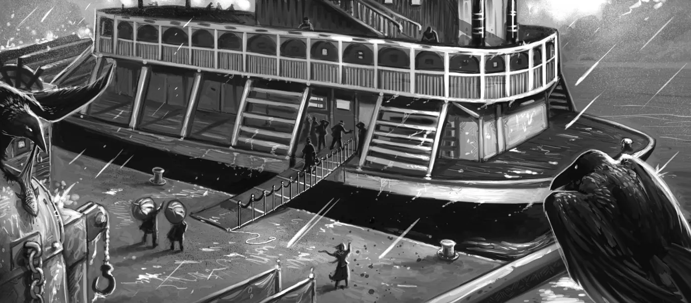

…бальном зале, чтобы пометить каждую жертву ритуальными письменами. Едва они начинают работу, как Фелисию, всё сильнее возбуждаемую мыслями о близкой церемонии, охватывает превращение. На её ладонях раскрываются багровые рты, и она питается пассажирами. Раздувшись от крови и наполовину обезумев от превращения, приёмыш набрасывается на Канлиффа и его команду. Их спасает то, что несколько её жертв приходят в себя раньше времени: кристаллической вытяжки мандрагоры оказалось слишком мало для списка гостей, расширенного за счёт сыщиков. Очнувшиеся бегут в коридоры и каюты колёсного парохода. Пресыщенный, разъярённый и исступлённый, приёмыш выслеживает их в череде кровавых погонь. Тем временем Канлифф, поняв, что всё потеряно, готовит котлы *«Луизианской леди»* к взрыву и бежит на шлюпке парохода с несколькими пленниками и уцелевшей командой. Ошибочно решив, что живых на борту не осталось, приёмыш переключается на Канлиффа и преследует его на острове Мертвеца.

Сыщики приходят в сознание после того, как она покидает судно. Выбравшись из своей каюты, они обнаруживают, что заперты на речном пароходе, полном трупов, окружённом неестественным туманом и, по всей видимости, стоящем на якоре посреди открытой воды. Исследуя судно, они смогут восстановить план Канлиффа, узнать кое-что о гостях Гранта и найти других выживших. Подробное описание состояния судна после бойни, устроенной приёмышем, дано ниже, в разделе о *«Луизианской леди»*. Если Хранитель хочет использовать **«Ужас на Темзе»** как часть кампании, он может изменить или дополнить эти сведения и раздатки для сыщиков.

Когда сыщики осмотрят судно, тревожные звуки из котлов парохода дадут им понять, что появилась новая опасность.

### Покинуть корабль

Третий акт начинается после того, как сыщики обыскали пароход и обнаружили, что котлы *«Луизианской леди»* подготовлены к взрыву. Никакое знание механики не предотвратит катастрофический взрыв. Сыщикам повезло лишь в том, что отлив отступил достаточно, чтобы мелкосидящий пароход частично сел на илистый берег острова Мертвеца — участка болота, едва поднимающегося над уровнем моря. Сыщики и другие выжившие могут покинуть судно, спрыгнув вниз в ил (трудная проверка Прыжков; при провале — 1d2 урона), или быстро найти и пустить в ход сходни, сложенные на носу судна, а затем пробраться через трясину на возвышенность. Чтобы усилить напряжение, Хранитель может подчеркнуть, как срочно нужно покинуть *«Луизианскую леди»* и как тяжело брести по густой береговой грязи. Когда сыщики отойдут на безопасное расстояние, пароход взрывается.

Теперь сыщиков ждут новые испытания. Канлифф и его команда добрались до относительной безопасности *«Эллен Бричестер»* и выпустили своё небольшое стадо болотных зомби, чтобы задержать приёмыша. Однако зомби нападают на всё живое, и сыщикам, возможно, придётся сражаться и с…

