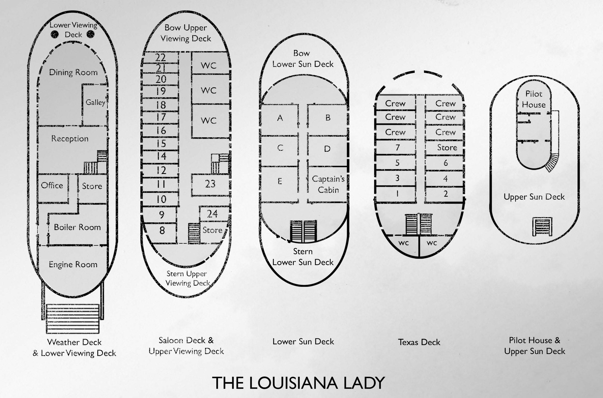

…зомби, и с приёмышем. Однако главная цель превратившейся Фелисии — Канлифф и его люди. Баржа-храм Учеников Алой Ладони села на мель и наполовину ушла в ил в северо-западной части острова. Добравшись до храма, сыщики должны будут одолеть приёмыша, *а также* Канлиффа и культистов, если хотят спасти удерживаемых там пленников.

### «Луизианская леди»

*«Луизианская леди»* — кормовой колёсный пароход с деревянным корпусом длиной 60 м. Построенный в 1890 году в Эйвондейле (Луизиана), он имеет ширину 10,7 м и осадку чуть больше 1,5 м. Его приводят в движение две одноцилиндровые горизонтальные паровые машины мощностью 16 лошадиных сил (цилиндр 16 дюймов, ход поршня 54 дюйма — около 40 и 137 см). В зависимости от течения реки он идёт со скоростью от 13 до 19 км/ч. Пароход полностью переоборудован и восстановлен фирмой «Джон И. Торникрофт и компания» за весьма немалые деньги Таддеуса Гранта. Салонная палуба переделана в пассажирские каюты, а обеденную зону разгородили, чтобы выделить приёмную и контору. На техасской и салонной палубах добавлены уборные. Все двери снабжены качественными замками, и любая попытка вскрыть их считается трудной проверкой Взлома. Двери можно также открыть подходящим ключом от каюты (он всегда у соответствующего гостя), общим ключом от кают, который лежит в конторе на главной палубе, — или выломать. Все двери имеют СИЛ 15, если не указано иное. В каждой каюте для гостей — небольшая двуспальная кровать, две прикроватные тумбочки, комод и компактные шкафы. Хотя в каждой каюте есть открывающееся наружу окно, ни одно не настолько велико, чтобы через него можно было пролезть.

*Прим. перев.: так в оригинале — «СИЛ 15»; по-видимому, это остаток шкалы 6-й редакции (на с. 13 дверь каюты команды A имеет уже СИЛ 75).*

В целом *«Луизианская леди»* роскошно отделана: богатая парчовая обивка и драпировки, начищенная латунная фурнитура, морёные и лакированные деревянные панели на стенах. Таддеус Грант охотно расскажет любому заинтересованному об этих переделках в устройстве и убранстве судна. Он также поговорит о картинах, украшающих стены общих помещений, — среди них «Гигантские пароходы в Новом Орлеане» Ипполита Себрона (1853) в обеденном зале и «„Омаха“ запасается дровами при лунном свете» Гэри Люси (1856) в приёмной. Но больше всего он гордится картиной Джорджа Ф. Фуллера «Гонка пароходов на Миссисипи»…

**Ключ к плану «Луизианской леди»** (слева направо):

| Палуба (подпись на плане) | Помещения |
|---|---|
| Weather Deck & Lower Viewing Deck — главная палуба и нижняя смотровая палуба | Lower Viewing Deck — нижняя смотровая палуба; Dining Room — обеденный зал; Galley — камбуз; Reception — приёмная; Office — контора; Store — кладовая; Boiler Room — котельная; Engine Room — машинное отделение |
| Saloon Deck & Upper Viewing Deck — салонная палуба и верхняя смотровая палуба | Bow Upper Viewing Deck — носовая часть верхней смотровой палубы; каюты 8–24; WC — уборные; Store — кладовая; Stern Upper Viewing Deck — кормовая часть верхней смотровой палубы |
| Lower Sun Deck — нижняя солнечная палуба | Bow Lower Sun Deck — носовая часть нижней солнечной палубы; A–E — каюты команды A–E; Captain’s Cabin — каюта капитана; Stern Lower Sun Deck — кормовая часть нижней солнечной палубы |
| Texas Deck — техасская палуба | Crew — каюты команды (шесть); каюты 1–7; Store — кладовая; WC — уборные |
| Pilot House & Upper Sun Deck — рулевая рубка и верхняя солнечная палуба | Pilot House — рулевая рубка; Upper Sun Deck — верхняя солнечная палуба |
