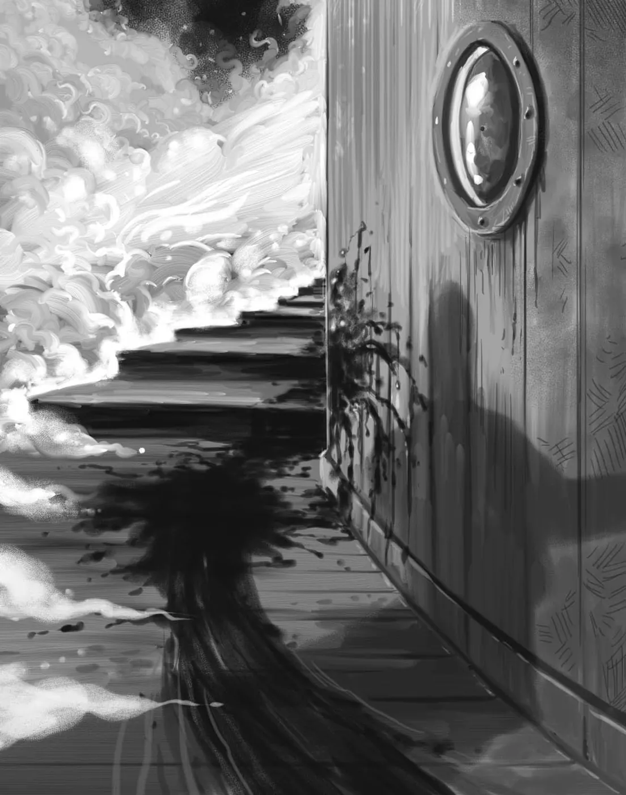

**Каюта команды D — джаз-бэнд «Дрискилл-Маунтин»: Бенни Грейс, Тони «Большой Ти» Лейн, Джо Пойндекстер, Лестер Миллс и Флетчер «Флетч» Конрад**

Дверь каюты заперта. Внутри на четырёх койках громоздятся чемоданы, а пятая постель устроена на полу. Беглый обыск обнаруживает американские паспорта музыкантов, одежду на каждого на две недели и три бутылки ирландского виски «Джон Пауэр и сын», сорт «Три ласточки». Одна пуста. Под одной из полных бутылок лежит визитная карточка с портретом Таддеуса Гранта. Поверх напечатанного написано: «Добро пожаловать в цивилизованную страну, ребята! Развлекайтесь! Завтра вечером — приличное жильё».

**Каюта команды E — Джеймс Бланден, капитан; Альберт Кольер, старший помощник; Джордж Торнтон, второй помощник**

Дверь заперта. Если сыщики войдут, они найдут каюту прибранной и упорядоченной. Скудные личные вещи трёх моряков сложены в двух шкафах. На одной из коек лежит экземпляр «Богов Марса» Эдгара Райса Берроуза (A. C. McClurg, 1918). Успешная проверка Внимания обнаружит потайной карман в куртке. В нём — небольшая коллекция эротических фотографий. У всех изображённых на них людей выжжены лица. Если сыщики обыщут шкафы, они найдут поношенный бушлат. В нём — письмо Канлиффа Бландену (см. **раздатку 2**), где объясняется, что команду для *«Луизианской леди»* нужно набрать из числа «Учеников». Почерк совпадает с почерком тревожной открытки ко дню рождения из каюты 7. На дне одного из шкафов двумя стопками сложены семь облачений с той же вышивкой, что в каютах команды B и C. Четыре — того же качества, что и в других каютах. Но три намного богаче, и более тонкая вышивка ясно показывает, что в ладони каждой алой руки — рот, а не глаз без век.

**Каюта капитана (Таддеус Грант)**

Дверь с табличкой «Капитан» не заперта. Это каюта капитана Бландена, которую на время круиза занимает Грант. Личные вещи в каюте указывают, что она принадлежит Гранту, но на первый взгляд для сыщиков здесь мало интересного, кроме весьма изящного курительного шкафчика красного дерева на комоде. В нём сыщики найдут две трубки-калебаса, две сигары «Бок-и-Ка Эксепсьоналес» и маленький кожаный кисет с гашишем (опознаётся успешной проверкой Медицины, Естествознания или Науки). Заглянув под кровать, они обнаружат запертый железный ящик. Его можно открыть ключом с трупа Бландена в рулевой рубке или вскрыть успешной **трудной** проверкой Взлома. Внутри — револьвер «Энфилд» Mk I калибра .476 с шестью патронами (1d10+2).

#### Верхняя смотровая палуба

С верхней смотровой палубы открывается вид на стену густого, липкого тумана, вязко облепившего поручни и трубы судна. Если сыщики ещё не нашли Ивонн Форбс-Пеннингтон, они услышат её сдавленные рыдания со смотровой палубы прямо под ними.

#### Верхняя солнечная палуба

Когда сыщики выйдут на верхнюю солнечную палубу, прочитайте или перескажите следующее:

*Ступив на верхнюю солнечную палубу, вы поражаетесь тишине. Дождь кончился. Не кричат ночные птицы, не плещется рыба, нет даже шелеста ветра. Всё жутко безмолвно. Туман клубится во тьме, медленно движется, его щупальца ласкают корпус судна, палубу, ваше лицо. Кровавый след тянется от рулевой рубки к трапу.*

Даже с высоты верхней палубы ничего не видно — ни реки, ни острова Мертвеца. Ночь и туман слишком густы.
