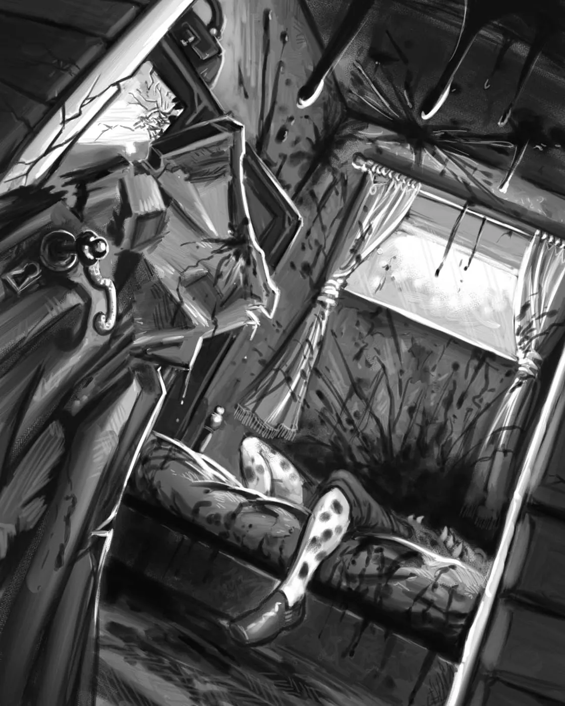

**Кладовая**

Здесь есть ряд вещей, которые могут пригодиться сыщикам. Беглый обыск даёт 10 м верёвки, лом (как дубинка, 1d4+1), ручной топор (как дубинка, 1d6+1 + БкУ), молоток (как дубинка, 1d4+1 + БкУ) и три заправленных керосиновых фонаря.

#### Салонная палуба

Салонная палуба — главная пассажирская палуба *«Луизианской леди»*; на ней 16 кают с номерами 8–12 и 14–24. Номера 13 нет, потому что он считается несчастливым. В носовой части судна — смотровая палуба с видом на нос. Лестница из приёмной ведёт в общее помещение, откуда коридоры расходятся к носу и к корме. Три ватерклозета расположены по правому борту парохода. В нескольких местах на полу пятна крови и кровавые следы, а к носовым каютам и от них тянется полоса широких, тёмных и блестящих мазков.

Тело Патрика Коттрелла лежит на верхней площадке лестницы. Осмотр тела покажет синяки в форме ладони со следами укусов в центре. Успешная проверка Внимания обратит внимание на раны на предплечьях — он оборонялся. Рядом с трупом лежит лопата (1d3 + БкУ), по краю испачканная сукровицей.

**Уборные**

Как и ватерклозеты техасской палубы, это роскошные удобства с сантехникой фирмы «Колер». Все они целы.

**Каюта 8 — Лоуренс Эштон**

Дверь заперта. Это удобная каюта с двуспальной кроватью, двумя большими шкафами и двумя комодами. На кровати лежит неоткрытый маленький чемодан. Его замки можно взломать силой (СИЛ 5) или вскрыть отмычкой (трудная проверка). Внутри — смена мужской одежды, бритвенный прибор (включая опасную бритву (навык ножа, 1d3)) и металлическая шкатулка с замком. В ней три письма, в которых Лоуренса Эштона шантажируют, требуя денег и угрожая рассказать о его пристрастии к проституткам его невесте Элис Брайхаус, наследнице судоходного состояния Брайхаусов (см. **раздатки 4, 5 и 6**).

*Прим. перев.: так в оригинале — «СИЛ 5» (вероятно, остаток шкалы 6-й редакции). Элис Брайхаус здесь — наследница судоходного состояния, а на с. 30 — дочь судьи Высокого суда.*

**Каюта 9 — Алистер Кэмпион-Ривз**

Дверь каюты не заперта. Рядом с двуспальной кроватью стоит потрёпанный дорожный сундук. Кожаная багажная бирка указывает, что он принадлежит Алистеру Кэмпион-Ривзу. Обыскав сундук, сыщики найдут лишь практичного покроя мужскую одежду, безопасную бритву «Валет Автостроп» и флакон розовой воды. Успешная проверка Внимания обнаружит у сундука двойное дно. Под ним — самозарядный пистолет «Кольт» M1911 калибра .45 (1d10+2) и 43 патрона в двух коробках.

**Каюта 10 — Уильям Канлифф**

Дверь заперта. Войдя, сыщики найдут каюту пустой, если не считать одного запертого чемодана. Успешная **трудная** проверка Взлома откроет его: внутри — роскошно вышитое серое облачение с изображением алой ладони, в центре которой — открытый зубастый рот. В длинном деревянном футляре — два блестящих филейных ножа с костяными рукоятями (1d6+2 каждый), покрытые гравировкой — геометрическим узором, напоминающим ровную каменную кладку. В рукоять каждого ножа вплетена жилка медной нити, выводящая слова: «Через боль я прихожу».

**Каюта 11 — Джерард Монтгомери и Дональд Уинтроп**

*Прим. перев.: так в оригинале — «Джерард»; везде в книге он Джеральд Монтгомери.*

Дверь сорвана с петель, и её расщеплённые остатки лежат на ковре, липком от засыхающей крови. На одной из кроватей распростёрто тело крупного мужчины: одежда разорвана, кожа покрыта огромными алыми рубцами.

Кровь забрызгала стены, пропитала простыни и брызнула на потолок. В воздухе резкий медный привкус. Все сыщики должны пройти проверку Рассудка. Любой сыщик, который…
