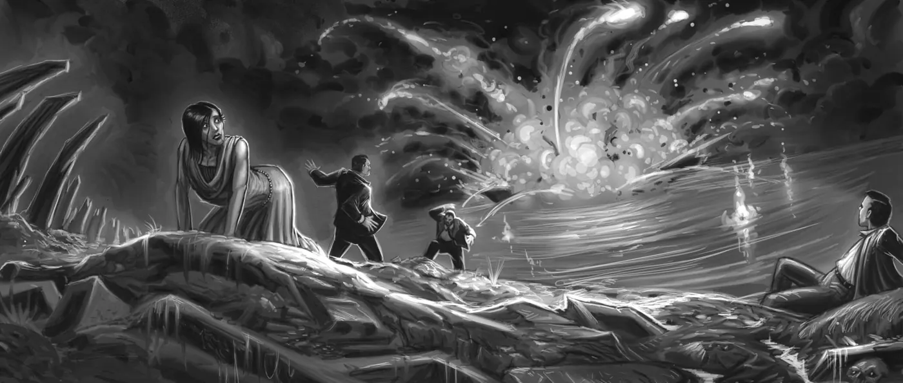

Когда сыщики находятся в носовой части судна, они могут услышать (при успешной проверке Слуха) плач Ивонн Форбс-Пеннингтон на нижней смотровой палубе. Если они на корме, огромная дуга гребного колеса неподвижно высится в тумане — совершенный символ их беспомощности.

## Часть вторая: остров Мертвеца

Остров Мертвеца — грязное пространство низменной, заболоченной земли у южного берега устья реки Медуэй. Бо́льшая часть острова — лабиринт болот, бурелома, старых разверстых могил, узких протоков и скользких расселин, ставших ещё коварнее из-за не по сезону сильных дождей. Грязь, стоячая вода и хрупкие крышки гробов делают путь вглубь острова опасным.

Тела, освобождённые из гниющих гробов размывом и волнами, здесь не редкость, и воздух пропитан смрадом разложения. Поэтому сыщики, скорее всего, найдут бо́льшую часть острова непроходимой и, увязнув в других направлениях, пойдут вдоль северного берега. Однако груды человеческих костей, обломки досок и всевозможный выброшенный морем хлам делают опасным даже берег. Выбравшись с *«Луизианской леди»*, каждый сыщик должен бросить d100. При результате 01–10 он должен пройти проверку ЛВК или получить 1d3 урона, поскользнувшись. Считается, что после этого первого опыта сыщики будут двигаться осторожнее. Однако Хранителю стоит требовать от сыщиков новых проверок, когда они пытаются бежать или сражаться на берегу или в болотах.

Держась линии прилива, сыщики быстро найдут *«Эллен Бричестер»*, но не без происшествий. Приближаясь к барже, они наткнутся на шестерых болотных зомби (ПЗ 10, 10, 10, 11, 12, 14; Укус 30%, 1d3), которых Канлифф выпустил из загона на *«Эллен Бричестер»*. Зомби нападут, если почуют сыщиков. Однако их можно обойти, если сыщики преуспеют в проверках Скрытности. Любой сыщик, проваливший проверку Скрытности, будет замечен и атакован. Если на сыщиков напали, бросьте d100. При результате 01–05 шум привлечёт приёмыша, который не обратит внимания на зомби и яростно набросится на сыщиков.

## «Эллен Бричестер»: храм Учеников Алой Ладони

*«Эллен Бричестер»* — заброшенная грузовая баржа длиной 65 м и шириной 11,7 м. В 1911 году она села на мель и сломала киль у западной оконечности острова Мертвеца. С 1918 года…

