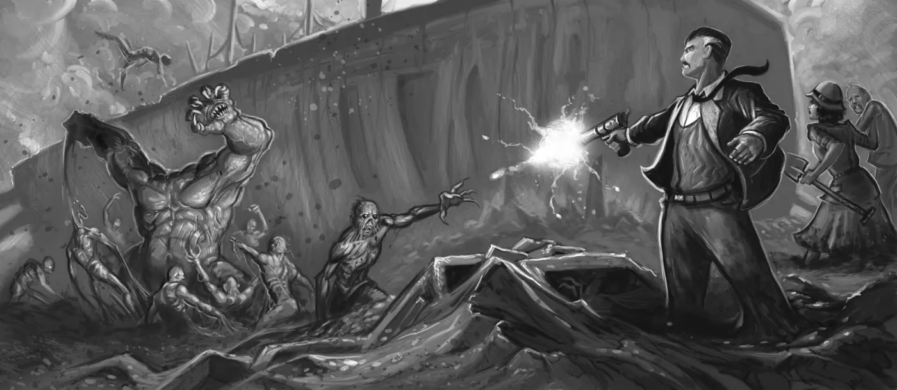

…— в ящиках, на полках или висящими в грубо сколоченных шкафах. Если сыщики осмотрят помещение, успешные проверки Истории или Оккультизма позволят опознать некоторые из самых малоизвестных приспособлений: «дочь мусорщика», «грушу страданий», черепные тиски, «кошачью лапу» и «коленолом». Назначение прочих вещей не поддаётся пониманию. Почти все они в пятнах.

Любой сыщик, преуспевший в **трудной** проверке Внимания, обнаружит потайной люк ближе к носу судна. Под ним в запертом металлическом ящике — ритуал, которым Канлифф собирался ускорить превращение Фелисии Ингрэм (+2% Мифов Ктулху).

## Завершение сценария

Если заложники убиты, а приёмыш и Ученики уничтожены, сыщикам, возможно, придётся немало потрудиться, чтобы убедить в своей версии местную полицию, которая прибудет около 6:30. Впрочем, баржа-храм, искажённое тело Фелисии Ингрэм и явные следы деятельности культа, скорее всего, обеспечат сыщикам освобождение без обвинений, особенно когда к делу подключится Отдел уголовного розыска. Однако в дальнейшем власти могут присматриваться к их делам.

Если сыщики *и все выжившие* решат не дожидаться властей и попытаются покинуть остров, они найдут небольшой паровой катер «Либертин», вытащенный на берег к западу от *«Эллен Бричестер»*. Он готов к отплытию и вмещает до двенадцати пассажиров. Очевидно, именно на нём Канлифф и его приспешники собирались вернуться на большую землю. Успешная проверка Ориентирования или Пилотирования (лодка) позволит сыщикам добраться до северного берега Медуэя или до Куинборо на острове Шеппи к востоку. Течения, извилистые протоки и низменные земли, такие же пустынные, как остров Мертвеца, делают другие места назначения недостижимыми. Добравшись до большой земли, сыщики сами решают, как действовать дальше.

Если выживут некоторые или все пленники, они подтвердят рассказ сыщиков о случившемся, и сыщики обретут влиятельных друзей, особенно Таддеуса Гранта. Они также заработают себе репутацию — со всеми вытекающими из этого хорошими и плохими последствиями. Если Ивонн Форбс-Пеннингтон выжила, она почти наверняка пригласит их сопровождать её в экспедиции в Египет, чтобы исследовать Вади-эль-Хитан и тайну «китов времени». Частную библиотеку Виктора Фэйрчайлда опишут и продадут частным образом.

Предприимчивые сыщики, возможно, захотят наведаться в его дом, пока этого не случилось. Лоуренс Эштон может попросить их помочь разобраться с тем, что кажется обычным шантажом. А ещё предстоит расследовать и разгадать тайну Уолтера Хамфриса. Вряд ли и Ученики Алой Ладони оставят потерю своего лондонского храма без возмездия.
