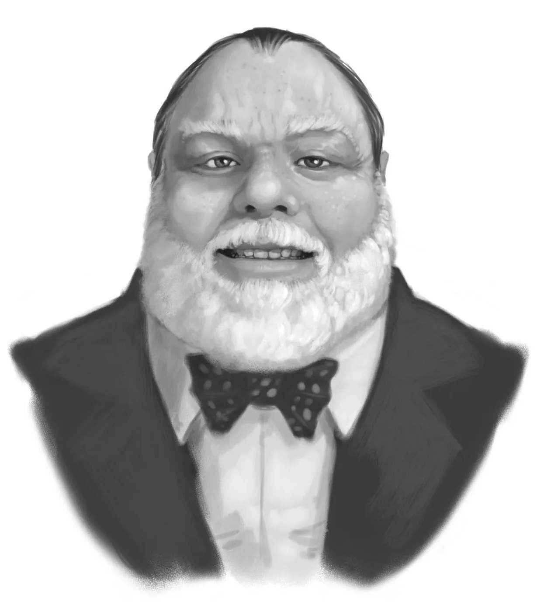

#### Джеймс Бланден

Бланден — крупный, грузный мужчина, чья окладистая борода начинает седеть. Сластолюбивый и часто жестокий, Бланден резок и неразговорчив.



```stat
Джеймс Бланден, 46 лет, капитан

СИЛ 65    ВЫН 80    ТЕЛ 75    ИНТ 55
МОЩ 65    ЛВК 60    НАР 45    ОБР 50
ПЗ 15     БкУ: +1d4   Комплекция: +1   Скорость: 6
Рассудок: 35

Атак за раунд: 1
Драка        40% (20/8), урон 1d3+1d4
Уклонение    30% (15/6)

Навыки: Средства 15%, Мифы Ктулху 25%, Красноречие 47%, Запугивание 60%, Механика 58%, Ориентирование 95%, Оккультизм 57%, Убеждение 52%, Плавание 93%.
```

#### Лесли Кори

Кори — ничем не примечательный человек, которого одиночество и отчуждённость привели в культ, где он может предаваться фантазиям о мести тем, кто ещё беззащитнее его. Он левша, но к шантажу Лоуренса Эштона не имеет никакого отношения.

```stat
Лесли Кори, 33 года, стюард

СИЛ 55    ВЫН 60    ТЕЛ 65    ИНТ 45
МОЩ 55    ЛВК 55    НАР 60    ОБР 40
ПЗ 12     БкУ: 0    Комплекция: 0    Скорость: 7
Рассудок: 42

Атак за раунд: 1
Драка        26% (13/5), урон 1d3
Нож боуи     26% (13/5), урон 1d4+2
Уклонение    27% (13/5)

Навыки: Средства 10%, Мифы Ктулху 22%, Ориентирование 34%, Оккультизм 46%, Плавание 27%.
```

#### Альберт (Берт) Кольер

Кольер высок, мускулист и хорош собой. Чаще всего ему поручают вербовать молодёжь в Ученики Алой Ладони или соблазнять будущих жертв.

```stat
Альберт (Берт) Кольер, 38 лет, старший помощник

СИЛ 75    ВЫН 60    ТЕЛ 75    ИНТ 60
МОЩ 65    ЛВК 60    НАР 85    ОБР 45
ПЗ 13     БкУ: +1d4   Комплекция: +1   Скорость: 8
Рассудок: 43

Атак за раунд: 1
Драка        29% (14/5), урон 1d3+1d4
Уклонение    30% (15/6)

Навыки: Бухгалтерское дело 64%, Обаяние 75%, Средства 10%, Мифы Ктулху 22%, Красноречие 58%, Ориентирование 45%, Оккультизм 54%, Убеждение 64%, Плавание 85%.
```

#### Уильям Фрамптон

Фрамптон — умный, учтивый самоучка; он руководил переделкой *«Эллен Бричестер»* в храм. Кроме того, он искусный резчик по кости (скримшоу) и предпочитает работать с человеческой костью, а не с другими материалами.
