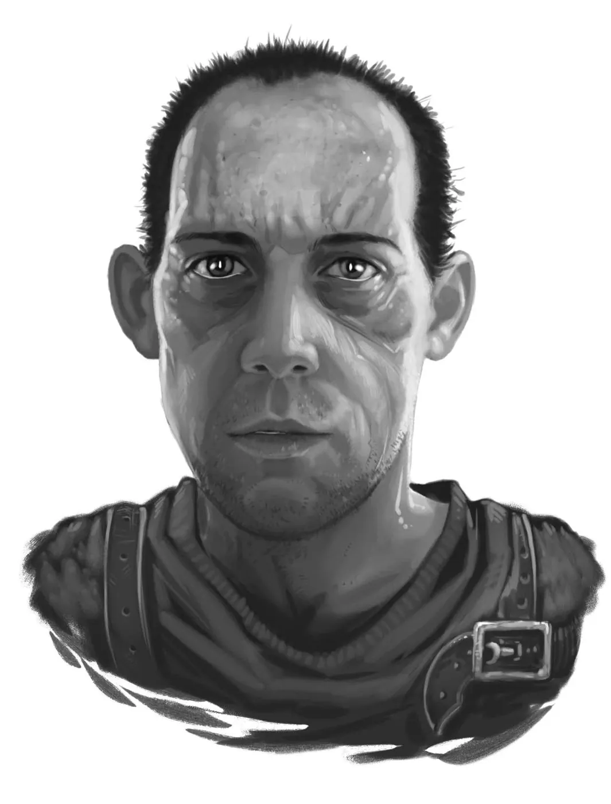

```stat
Уильям Фрамптон, 42 года, механик

СИЛ 75    ВЫН 55    ТЕЛ 70    ИНТ 75
МОЩ 45    ЛВК 65    НАР 60    ОБР 70
ПЗ 12     БкУ: +1d4   Комплекция: +1   Скорость: 7
Рассудок: 37

Атак за раунд: 1
Драка        25% (12/5), урон 1d3+1d4
Нож          25% (12/5), урон 2d4+2
Уклонение    32% (16/6)

Навыки: Искусство/ремесло (резьба по кости) 85%, Средства 15%, Мифы Ктулху 12%, Электрика 12%, Механика 78%, Оккультизм 21%, Внимание 38%.
```

*Прим. перев.: так в оригинале — урон ножа «2d4+2»; по-видимому, имелся в виду урон 1d4+2 вместе с БкУ +1d4.*

#### Джордж Торнтон

У Торнтона облик и повадки головореза: узколицый, вороватый и безжалостный. Ему часто поручают избавляться от жертв культа.



```stat
Джордж Торнтон, 31 год, второй помощник

СИЛ 60    ВЫН 55    ТЕЛ 40    ИНТ 70
МОЩ 60    ЛВК 75    НАР 45    ОБР 55
ПЗ 9      БкУ: 0    Комплекция: 0    Скорость: 9
Рассудок: 39

Атак за раунд: 1
Драка        37% (18/7), урон 1d3
Стилет       37% (18/7), урон 1d4+2
Уклонение    32% (16/6)

Навыки: Средства 10%, Мифы Ктулху 15%, Маскировка 46%, Красноречие 64%, Слух 43%, Взлом 62%, Ориентирование 36%, Скрытность 76%, Плавание 41%.
```

*Прим. перев.: так в оригинале — Уклонение 32%, хотя при ЛВК 75 оно не может быть ниже 37%.*

#### Уильям Петтс

Петтс, повар в «Стервятнике» в Лаймхаусе, — привередливый человечек: маленький, аккуратный и до педантичности чистый. Он упивается обрядами осквернения, которые практикуют Ученики Алой Ладони.

```stat
Уильям Петтс, 44 года, кок

СИЛ 45    ВЫН 75    ТЕЛ 45    ИНТ 60
МОЩ 55    ЛВК 65    НАР 65    ОБР 55
ПЗ 12     БкУ: 0    Комплекция: 0    Скорость: 7
Рассудок: 31

Атак за раунд: 1
Драка        31% (15/6), урон 1d3
Нож          31% (15/6), урон 1d4+2
Уклонение    32% (16/6)

Навыки: Искусство/ремесло (кулинария) 56%, Средства 10%, Мифы Ктулху 9%, Оккультизм 37%.
```
