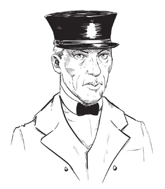
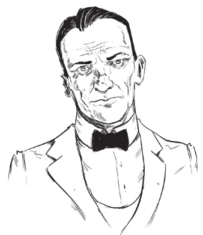
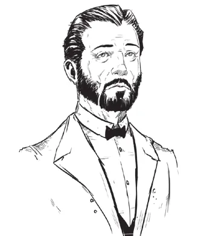
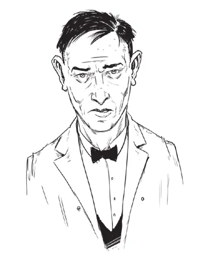
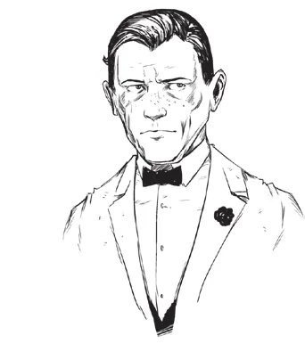
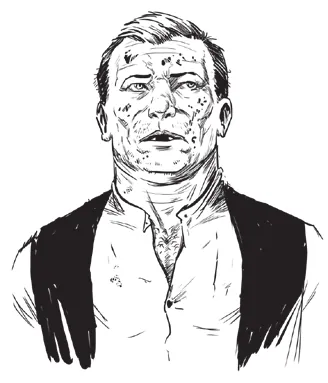
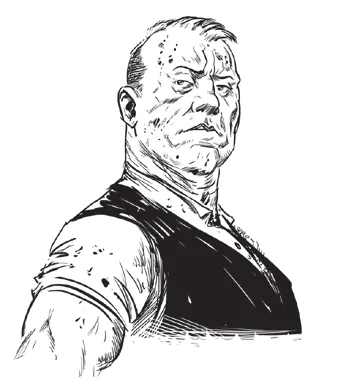
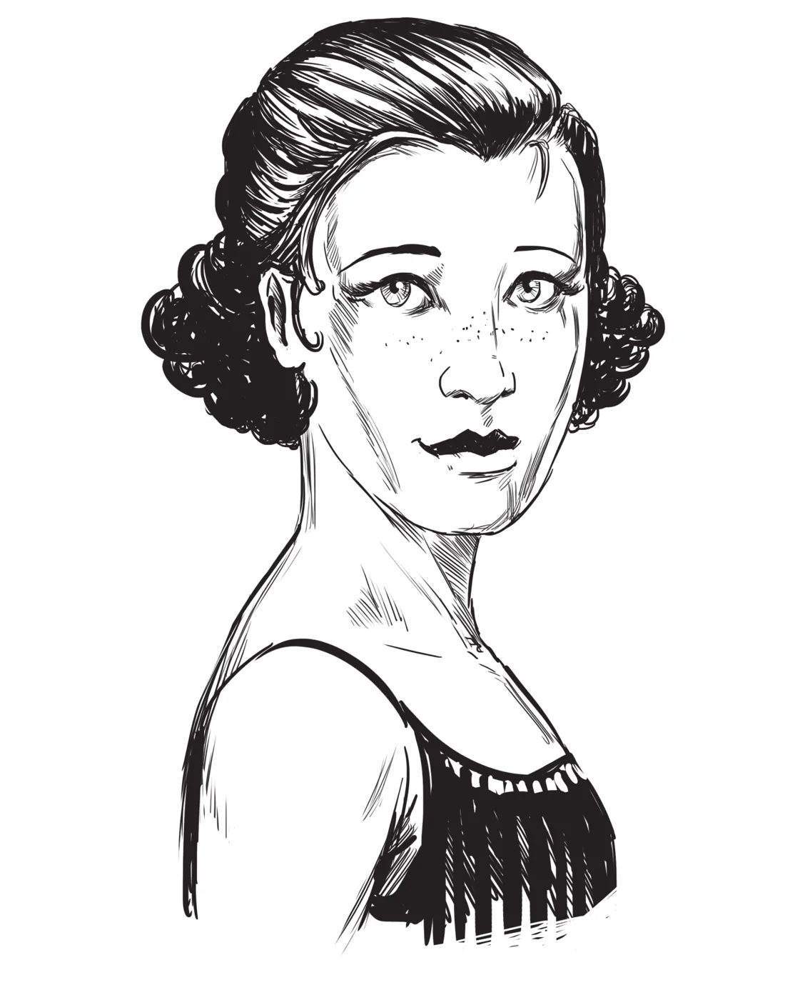

### Матросы

| Имя | СИЛ | ВЫН | ТЕЛ | ИНТ | МОЩ | ЛВК | НАР | ОБР | Рас. | ПЗ | БкУ | Компл. | Скор. |
|---|---|---|---|---|---|---|---|---|---|---|---|---|---|
| Фрэнк Уэлч, боцман | 60 | 60 | 60 | 60 | 60 | 55 | 65 | 45 | 35 | 12 | 0 | 0 | 9 |
| Томас Боуэн, матрос/официант | 60 | 70 | 55 | 45 | 55 | 65 | 70 | 45 | 43 | 12 | 0 | 0 | 9 |
| Джеймс Вулкот, матрос/официант | 55 | 75 | 60 | 50 | 55 | 60 | 40 | 35 | 32 | 13 | 0 | 0 | 8 |
| Джон Рэдли, матрос/официант | 65 | 65 | 50 | 40 | 60 | 50 | 50 | 50 | 48 | 11 | 0 | 0 | 8 |
| Дэниел Гуч, младший матрос/официант | 55 | 65 | 55 | 45 | 45 | 45 | 45 | 50 | 28 | 12 | 0 | 0 | 8 |
| Патрик Коттрелл, кочегар | 75 | 70 | 70 | 50 | 50 | 55 | 55 | 30 | 43 | 14 | 1d4 | +1 | 8 |
| Джордж Куэйл, кочегар | 75 | 75 | 75 | 55 | 60 | 65 | 35 | 50 | 27 | 15 | 1d4 | +1 | 8 |

**Оружие:** Нож 25% (12/5), 1d4+2 + БкУ; Драка 25%, 1d3 + БкУ.

Все матросы умеют обращаться с оружием: Стрельба (винтовка/дробовик) 35% (17/7).

*Прим. перев.: так в оригинале — у Фрэнка Уэлча Скорость 9, хотя по правилам 7-й редакции выходит 8.*

*Портреты матросов в ряд (слева направо, в порядке строк таблицы):*















### Пассажиры

#### Селеста Арчер

Селеста Арчер — образованная, очаровательная молодая женщина, поглощённая модой, сплетнями и последними романами в своём кругу.



```stat
Селеста Арчер, 22 года, «блестящая молодёжь»

СИЛ 50    ВЫН 55    ТЕЛ 45    ИНТ 65
МОЩ 45    ЛВК 65    НАР 70    ОБР 60
ПЗ 10     БкУ: 0    Комплекция: 0    Скорость: 9
Рассудок: 45

Атак за раунд: 1
Драка        25% (12/5), урон 1d3
Уклонение    32% (16/6)

Навыки: Обаяние 65%, Средства 75%, Этикет 78%, Иностранный язык (французский) 80%, Убеждение 62%, Верховая езда 60%, Плавание 42%.
```
