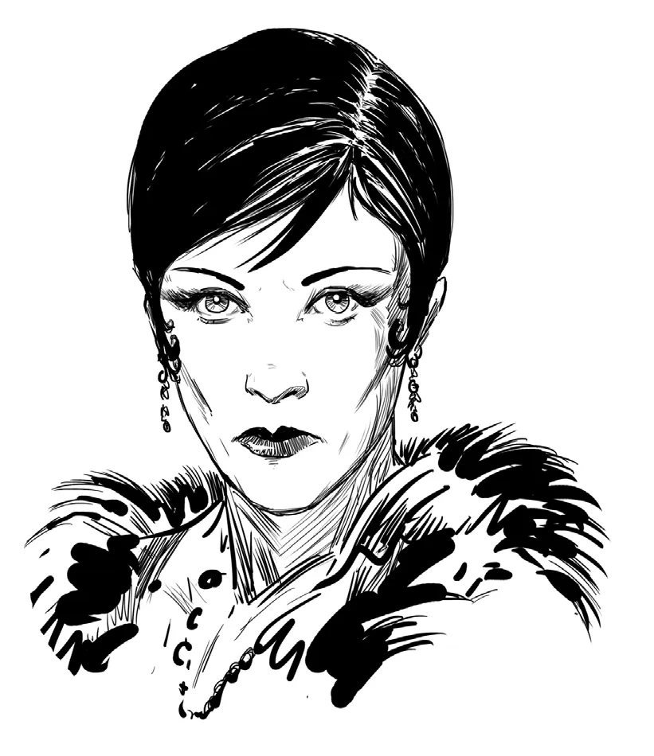

#### Ивонн Форбс-Пеннингтон

Замужем за стареющим мужем, Ивонн Форбс-Пеннингтон слывёт своевольной особой и находчивым, основательным и преданным делу археологом-любителем. Она уверена в себе, слегка высокомерна и не терпит дураков. В разговоре она весьма грозна, если находит собеседника скучным или туповатым.



```stat
Ивонн Форбс-Пеннингтон, 27 лет, археолог-любитель

СИЛ 60    ВЫН 80    ТЕЛ 60    ИНТ 80
МОЩ 65    ЛВК 65    НАР 70    ОБР 65
ПЗ 14     БкУ: 0    Комплекция: 0    Скорость: 9
Рассудок: 58

Атак за раунд: 1
Драка        25% (12/5), урон 1d4
Уклонение    32% (16/6)

Навыки: Археология 63%, Средства 85%, Вождение автомобиля 27%, История 56%, Работа в библиотеке 42%, Оккультизм 32%, Иностранный язык (арабский) 37%, Верховая езда 41%, Внимание 34%, Выживание 54%.
```

*Прим. перев.: так в оригинале — Скорость 9, по правилам 7-й редакции выходит 8.*

#### Таддеус Грант

Словоохотливый, обаятельный и добродушный Таддеус Грант — джентльмен-южанин, сколотивший состояние на морских перевозках, а затем продавший свои доли и переселившийся в Англию, где надеется найти жену, загородное поместье и признание у английского дворянства. Он ценит хорошую еду, приключенческую литературу и прямолинейных женщин. Кроме того, Грант — страстный покерист сомнительного таланта. На вопрос, почему он приехал в Англию, он объявит, что бежал от закона Волстеда, и сообщит всем, кто готов слушать: «Ни одна цивилизованная страна не запрещает свободно пить хорошие напитки».


```stat
Таддеус Грант, 43 года, американский миллионер, саморекламщик и покерист

СИЛ 70    ВЫН 75    ТЕЛ 65    ИНТ 65
МОЩ 75    ЛВК 60    НАР 70    ОБР 65
ПЗ 14     БкУ: +1d4   Комплекция: +1   Скорость: 7
Рассудок: 65

Атак за раунд: 1
Драка        45% (22/9), урон 2d4
Уклонение    30% (15/6)

Навыки: Бухгалтерское дело 75%, Средства 99%, Вождение автомобиля 21%, Этикет 44%, Красноречие 72%, Юриспруденция 37%, Иностранный язык (французский) 34%, Убеждение 63%, Стрельба (дробовик) 54%, Верховая езда 41%, Стрельба (винтовка) 62%.
```
