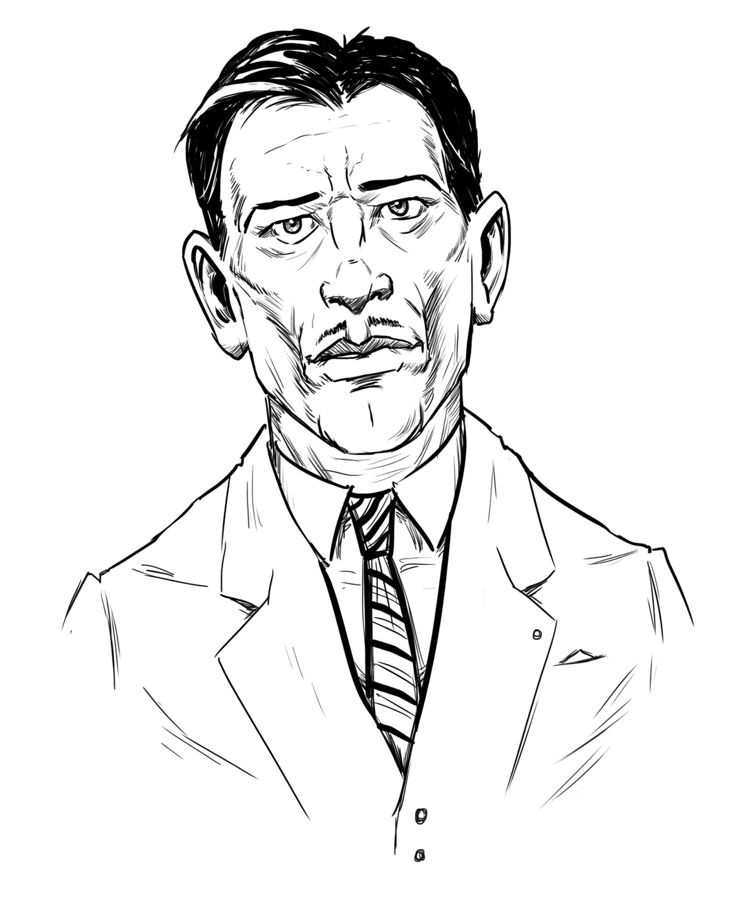
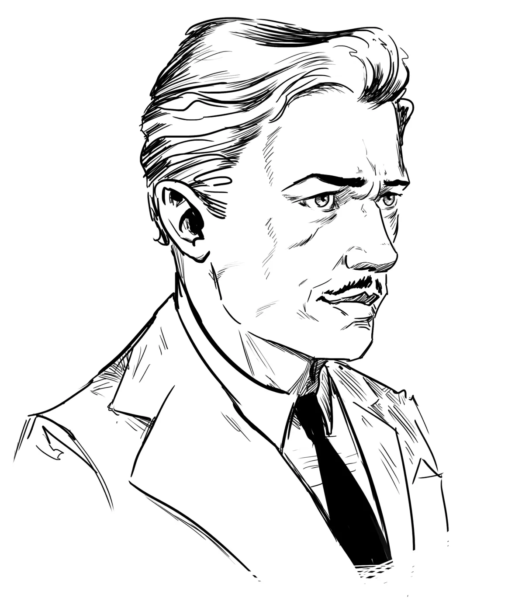

#### Джеральд Монтгомери

Джеральд Монтгомери — профессиональный зритель. Он обожает смотреть спорт и наблюдать за людьми. Сказать ему особенно нечего: он предпочитает развлекаться, сочиняя истории — порой весьма непристойные — о похождениях тех, с кем водит компанию. Он нездоров ни умом, ни телом.



```stat
Джеральд Монтгомери, 24 года, джентльмен

СИЛ 55    ВЫН 45    ТЕЛ 65    ИНТ 60
МОЩ 70    ЛВК 55    НАР 70    ОБР 65
ПЗ 11     БкУ: 0    Комплекция: 0    Скорость: 7
Рассудок: 68

Атак за раунд: 1
Драка        25% (12/5), урон 1d3
Уклонение    27% (13/5)

Навыки: Бухгалтерское дело 14%, Оценка 21%, Обаяние 28%, Средства 65%, Вождение автомобиля 41%, Этикет 83%, Иностранный язык (латынь) 43%, Убеждение 21%, Стрельба (дробовик) 42%.
```

#### Джеймс Невилл

Джеймс Невилл — повеса, погубивший репутацию нескольких молодых женщин. А ещё он влюблён в Вайолет Гиббс-Вульф. Разрываясь между желанием обладать ею и нежеланием относиться к ней иначе, чем к богине, он обречён выставлять себя дураком.



```stat
Джеймс Невилл, 27 лет, повеса

СИЛ 60    ВЫН 65    ТЕЛ 60    ИНТ 70
МОЩ 70    ЛВК 50    НАР 75    ОБР 70
ПЗ 12     БкУ: 0    Комплекция: 0    Скорость: 8
Рассудок: 62

Атак за раунд: 1
Драка        25% (12/5), урон 1d3
Уклонение    25% (12/5)

Навыки: Бухгалтерское дело 33%, Оценка 23%, Бокс 41%, Обаяние 56%, Средства 65%, Вождение автомобиля 42%, Этикет 76%, Убеждение 64%, Стрельба (дробовик) 61%.
```
