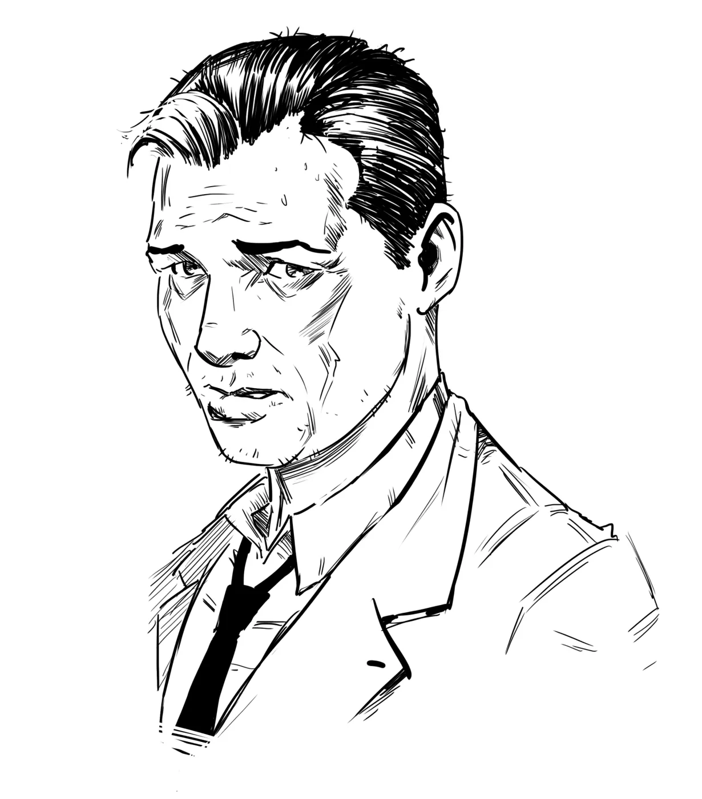
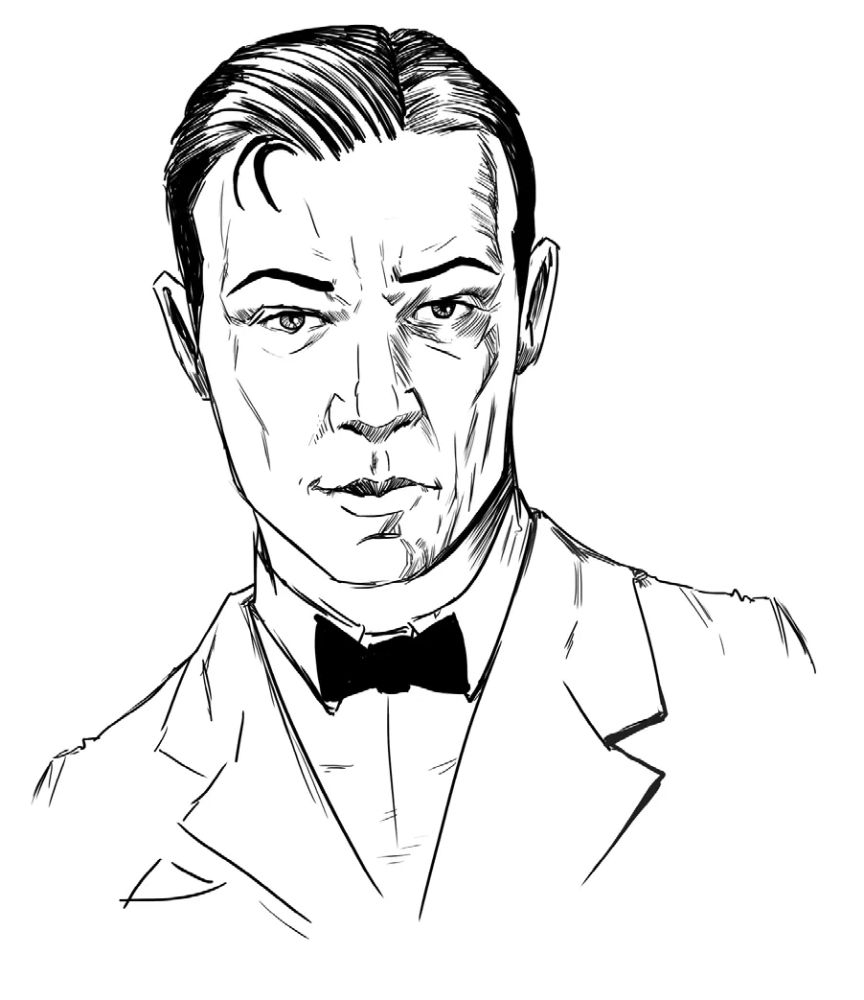

#### Альфред Пребл

Альфред Пребл — человек встревоженный. Потеряв в прошлом году обоих родителей, он живёт в страхе смерти. До сих пор он искал утешения в мировых религиях, но недавно стал получать письма и открытки, которые, хоть и не являются прямыми угрозами смертью, подорвали его уверенность в бессмертии души. Он нервный, робкий, как мышь, человек, популярный лишь благодаря состоянию, которое унаследовал после того, как его родителей насмерть сбил трамвай на набережной.



```stat
Альфред Пребл, 24 года, человек без веры

СИЛ 65    ВЫН 60    ТЕЛ 65    ИНТ 45
МОЩ 65    ЛВК 60    НАР 55    ОБР 60
ПЗ 12     БкУ: +1d4   Комплекция: +1   Скорость: 8
Рассудок: 32

Атак за раунд: 1
Драка        25% (12/5), урон 1d3+1d4
Уклонение    30% (15/6)

Навыки: Бухгалтерское дело 40%, Оценка 20%, Средства 90%, Вождение автомобиля 31%, Этикет 73%, Стрельба (винтовка) 31%, Юриспруденция 27%, Работа в библиотеке 29%, Иностранный язык (французский) 23%.
```

#### Альберт Родс

Давний «охотничий» напарник Джеймса Невилла, Родс — бессердечный манипулятор женщинами. Джозефина Шоукросс — его последняя жертва, но ему уже наскучило, что ей недостаёт смелости. Генриетта Уайлд с её украдкой брошенными взглядами и экзотической внешностью кажется ему куда соблазнительнее. А если случится скандал, он уверен, что её отец, достопочтенный Бартоломью Уайлд, член парламента, окажется достаточно щедр, чтобы купить его молчание.



```stat
Альберт Родс, 26 лет, джентльмен

СИЛ 70    ВЫН 60    ТЕЛ 60    ИНТ 75
МОЩ 70    ЛВК 65    НАР 75    ОБР 70
ПЗ 13     БкУ: +1d4   Комплекция: +1   Скорость: 9
Рассудок: 62

Атак за раунд: 1
Драка        25% (12/5), урон 1d3+1d4
Уклонение    32% (16/6)

Навыки: Оценка 42%, Обаяние 65%, Средства 75%, Вождение автомобиля 32%, Этикет 78%, Красноречие 61%, Стрельба (винтовка/дробовик) 24%, Слух 45%, Убеждение 67%.
```

*Прим. перев.: так в оригинале — ПЗ 13, по правилам выходит 12.*
