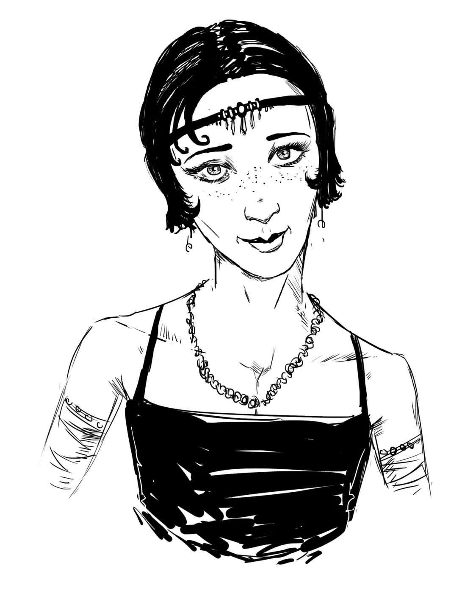
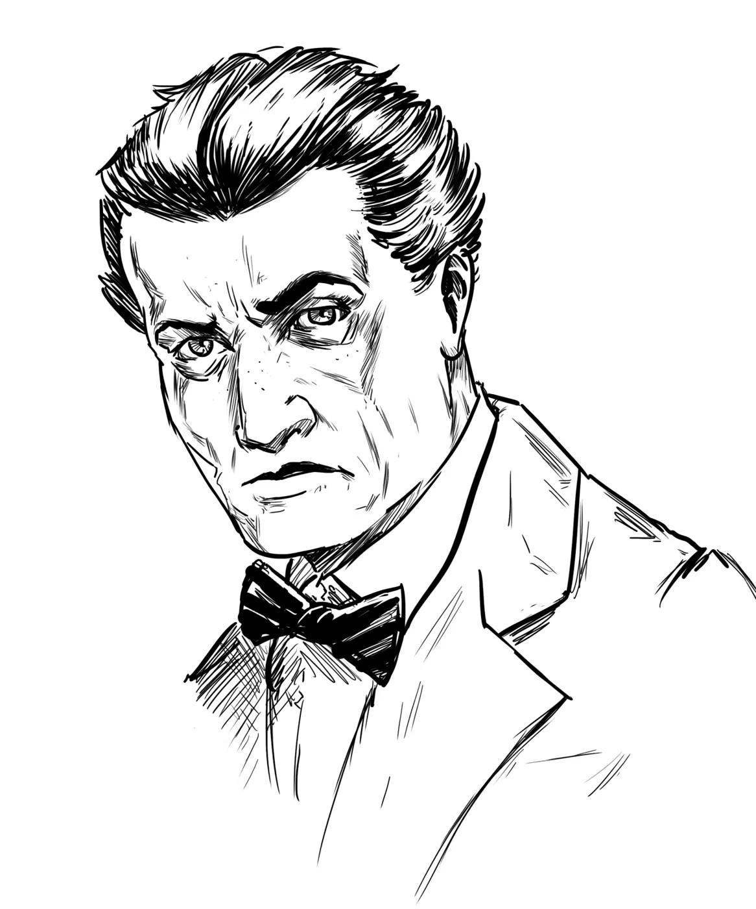

#### Джозефина Шоукросс

Наивная, доверчивая и по-детски простодушная Джозефина Шоукросс — последняя молодая женщина, ставшая жертвой хищных повадок Альберта Родса. Она безнадёжно влюблена и без умолку говорит о таинственном возлюбленном, которого не одобрил бы её отец. Она убедила себя, что в 1921 году выйдет замуж.



```stat
Джозефина Шоукросс, 21 год, «блестящая молодёжь»

СИЛ 45    ВЫН 55    ТЕЛ 50    ИНТ 50
МОЩ 65    ЛВК 55    НАР 70    ОБР 55
ПЗ 11     БкУ: 0    Комплекция: 0    Скорость: 8
Рассудок: 60

Атак за раунд: 1
Драка        25% (12/5), урон 1d3
Уклонение    27% (13/5)

Навыки: Оценка 34%, Обаяние 47%, Средства 75%, Вождение автомобиля 22%, Этикет 78%, Стрельба (дробовик) 34%, Иностранный язык (французский) 23%, Плавание 57%, Верховая езда 29%.
```

#### Дональд Уинтроп

Дональд Уинтроп — убийца и морфинист. После того как Эмили Джонс оборвала их короткую связь, чтобы выйти замуж за Гордона Додда, Уинтроп стал одержим ею. Одержимость привела его к убийству её мужа. Теперь Уинтроп пытается вернуться в общество, чтобы казаться равнодушным к Эмили, которая, как он надеется, однажды снова в него влюбится. Поэтому он чересчур дружелюбен и из кожи вон лезет, чтобы угодить.



```stat
Дональд Уинтроп, 28 лет, убийца

СИЛ 80    ВЫН 55    ТЕЛ 60    ИНТ 70
МОЩ 50    ЛВК 60    НАР 65    ОБР 80
ПЗ 11     БкУ: +1d4   Комплекция: +1   Скорость: 9
Рассудок: 32

Атак за раунд: 1
Драка        28% (14/5), урон 1d3+1d4
Уклонение    30% (15/6)

Навыки: Оценка 22%, Обаяние 35%, Средства 45%, Вождение автомобиля 52%, Этикет 78%, Красноречие 56%, Стрельба (дробовик) 64%, Слух 45%, Убеждение 47%.
```

*Прим. перев.: так в оригинале — Скорость 9, по правилам 7-й редакции выходит 8.*
