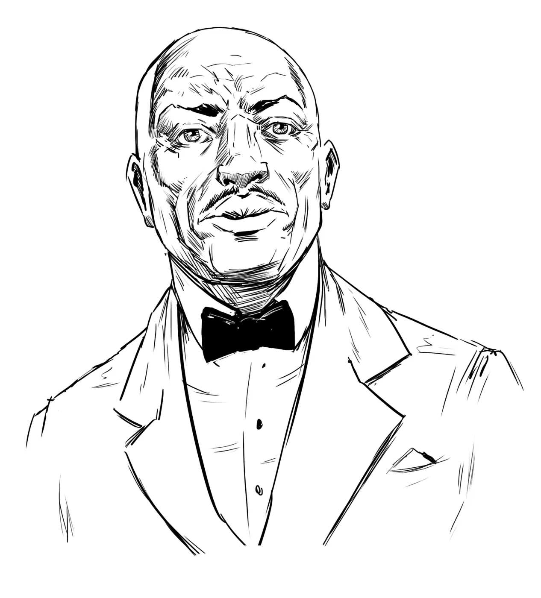

### Джаз-бэнд «Дрискилл-Маунтин»

#### Джо Пойндекстер

Джо Пойндекстер женат, у него двое детей. Он впервые уехал от них и ужасно скучает. Он хочет домой. Англия оказалась не такой, как он думал. Погода паршивая, люди, кажется, вечно над ним смеются и, похоже, не умеют веселиться без жестокости.


```stat
Джо Пойндекстер, 29 лет, корнетист

СИЛ 60    ВЫН 55    ТЕЛ 60    ИНТ 55
МОЩ 50    ЛВК 75    НАР 50    ОБР 55
ПЗ 11     БкУ: 0    Комплекция: 0    Скорость: 9
Рассудок: 48

Атак за раунд: 1
Драка        25% (12/5), урон 1d3
Уклонение    32% (16/6)

Навыки: Искусство/ремесло (корнет) 92%, Искусство/ремесло (импровизация) 75%, Обаяние 45%, Средства 20%, Слух 71%, Иностранный язык (французский) 58%.
```

*Прим. перев.: так в оригинале — Скорость 9 (по правилам 8) и Уклонение 32%, хотя при ЛВК 75 оно не может быть ниже 37%.*

#### Тони «Большой Ти» Лейн

«Большой Ти» — руководитель джаз-бэнда «Дрискилл-Маунтин». Они с Таддеусом Грантом давно дружили и выпивали вместе ещё в Луизиане, и Грант обещал, заработав первый миллион, сделать всё, чтобы бэнд прославился на весь мир. Играть для кучки состоятельных британцев на расфуфыренном речном пароходе — не так Тони представлял себе большой успех за океаном. Он недоволен.



```stat
Тони «Большой Ти» Лейн, 35 лет, тромбонист

СИЛ 70    ВЫН 60    ТЕЛ 90    ИНТ 65
МОЩ 55    ЛВК 80    НАР 65    ОБР 45
ПЗ 15     БкУ: +1d4   Комплекция: +1   Скорость: 7
Рассудок: 52

Атак за раунд: 1
Драка        25% (12/5), урон 1d3+1d4
Уклонение    40% (20/8)

Навыки: Искусство/ремесло (импровизация) 76%, Искусство/ремесло (тромбон) 90%, Обаяние 34%, Средства 20%, Красноречие 48%, Стрельба (дробовик) 44%, Слух 69%, Иностранный язык (французский) 67%.
```
