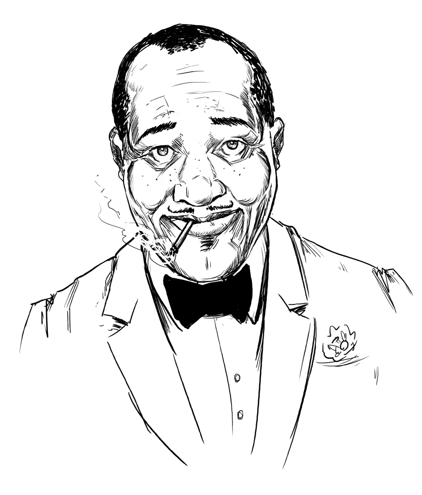

#### Лестер Миллс

Лестер Миллс не может поверить своей удаче. Как раз когда он думал, что придётся вернуться к перевозке грузов по Миссисипи, Большой Тони велел ему собираться в поездку в Англию. Лестер верит, что это его большой шанс. «Ни за что не вернусь, если только смогу, брат», — сказал он напоследок, прежде чем они начали выступление.



```stat
Лестер Миллс, 27 лет, кларнетист

СИЛ 55    ВЫН 55    ТЕЛ 55    ИНТ 65
МОЩ 60    ЛВК 80    НАР 60    ОБР 60
ПЗ 11     БкУ: 0    Комплекция: 0    Скорость: 9
Рассудок: 54

Атак за раунд: 1
Драка        25% (12/5), урон 1d3
Уклонение    40% (20/8)

Навыки: Искусство/ремесло (импровизация) 67%, Искусство/ремесло (кларнет) 89%, Обаяние 54%, Средства 20%, Слух 73%, Иностранный язык (французский) 22%.
```

*Прим. перев.: так в оригинале — Скорость 9, по правилам 7-й редакции выходит 8.*

#### Бенни Грейс

Малообразованный, родом из бедного квартала Нового Орлеана, Бенни Грейс чувствует себя на борту *«Луизианской леди»* не в своей тарелке. Он просто помалкивает и держит ритм.

```stat
Бенни Грейс, 34 года, барабанщик

СИЛ 80    ВЫН 80    ТЕЛ 65    ИНТ 50
МОЩ 45    ЛВК 90    НАР 45    ОБР 45
ПЗ 14     БкУ: +1d4   Комплекция: +1   Скорость: 9
Рассудок: 42

Атак за раунд: 1
Драка        35% (17/7), урон 1d3+1d4
Уклонение    45% (22/9)

Навыки: Искусство/ремесло (барабаны) 88%, Искусство/ремесло (импровизация) 78%, Обаяние 22%, Средства 15%, Слух 60%, Иностранный язык (французский) 76%.
```

#### Флетчер «Флетч» Конрад

Флетч — учтивый, словоохотливый и обаятельный пианист, неравнодушный к привлекательным дамам, с мягким южным выговором. Он умеет слушать и называет женщин на борту «шер».

```stat
Флетчер «Флетч» Конрад, 37 лет, пианист

СИЛ 65    ВЫН 60    ТЕЛ 65    ИНТ 55
МОЩ 50    ЛВК 85    НАР 65    ОБР 60
ПЗ 12     БкУ: +1d4   Комплекция: +1   Скорость: 9
Рассудок: 47

Атак за раунд: 1
Драка        25% (12/5), урон 1d3+1d4
Уклонение    42% (21/8)

Навыки: Искусство/ремесло (импровизация) 66%, Искусство/ремесло (фортепиано) 94%, Обаяние 62%, Средства 30%, Красноречие 58%, Слух 82%, Иностранный язык (французский) 68%, Убеждение 81%.
```

*Прим. перев.: так в оригинале — Скорость 9, по правилам 7-й редакции выходит 8.*
