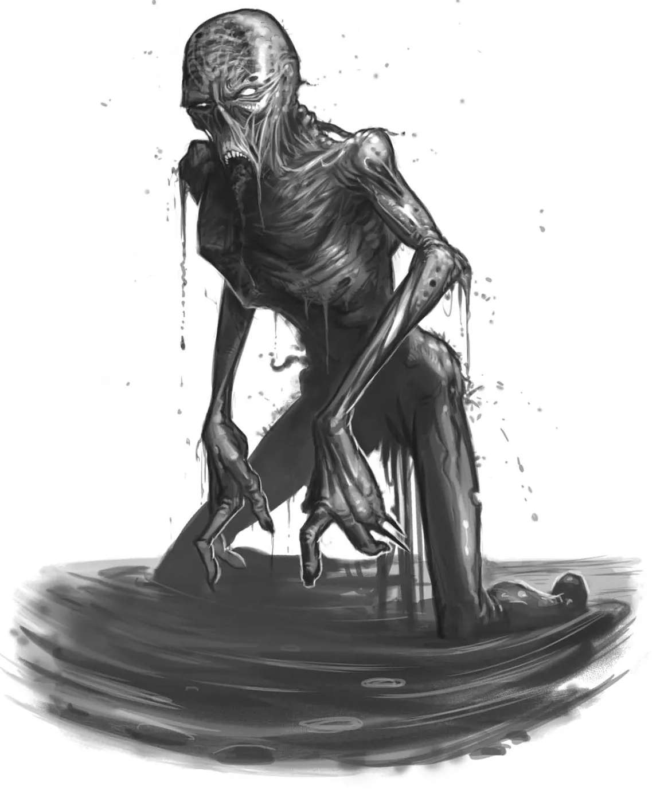

*Окончание сводной таблицы:*

| Имя | Каюта | Приметы и заметки | Судьба |
|---|---|---|---|
| Сыщик | 20 | | |
| Сыщик | 20 | | |
| Сыщик | 21 | | |
| Сыщик | 21 | | |
| Сыщик | 22 | | |
| Сыщик | 22 | | |
| Сыщик или пусто | 23 | | |
| Сыщик или пусто | 23 | | |
| Сыщик или пусто | 24 | | |
| Сыщик или пусто | 24 | | |
| **Музыканты** | | | |
| Бенни Грейс | каюта команды D | Барабанщик, малообразованный | Убит, обеденный зал |
| Тони «Большой Ти» Лейн | каюта команды D | Тромбонист, недовольный руководитель бэнда | Выжил, прячется в каюте 1 |
| Джо Пойндекстер | каюта команды D | Корнетист, хочет домой | Убит, обеденный зал |
| Лестер Миллс | каюта команды D | Кларнетист, считает Англию своим большим шансом | Убит, обеденный зал |
| Флетчер «Флетч» Конрад | каюта команды D | Пианист; учтивый, обаятельный, словоохотливый | Убит, обеденный зал |

*Прим. перев.: в таблице Эвелин Уэствуд — выжившая пленница, хотя на с. 20 её опознают среди мёртвых в обеденном зале.*

### Болотные зомби

Болотные зомби — оживлённые трупы, поднятые из болот или топкой земли. Как правило, они слабее других видов зомби из-за быстрого разложения и разжижения тканей, которое происходит в такой почве. Их можно поднять заклинаниями «Чёрные оковы» или «Создание зомби». Болотные зомби сохраняют телесную целостность 1d4 недели, после чего разложение их обездвиживает. Их нельзя уничтожить солью, и огонь на них не действует.



```stat
Болотные зомби

СИЛ 80    ВЫН 80    ТЕЛ 55    МОЩ 5
ЛВК 35    ПЗ 12     БкУ: +1d4   Комплекция: +1
ПМ 1      Скорость: 6

Атак за раунд: 1
Ближний бой  30% (15/6), урон 1d3+1d4
Уклонение    17% (8/3)

Броня: пронзающее оружие не причиняет урона, всё прочее — половину урона. Дробовики причиняют двойной урон.

Потеря Рассудка: 1/1d6 Рассудка за то, чтобы впервые увидеть болотного зомби.
```

*Прим. перев.: так в оригинале — ПЗ 12, хотя по ВЫН 80 и ТЕЛ 55 выходит 13; в сценах (с. 22, 23) у зомби разные ПЗ (10–14) и атака «Укус 30%, 1d3» вместо урона 1d3+1d4 в статблоке.*
