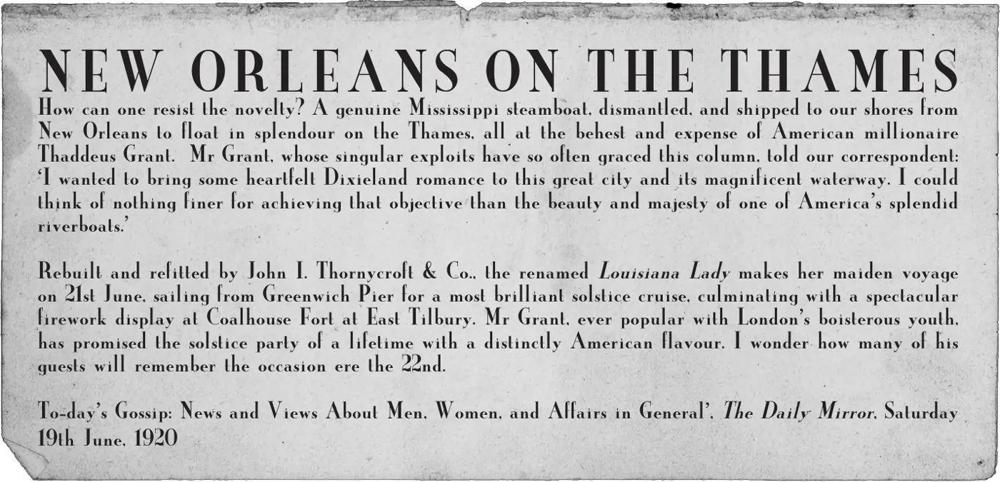
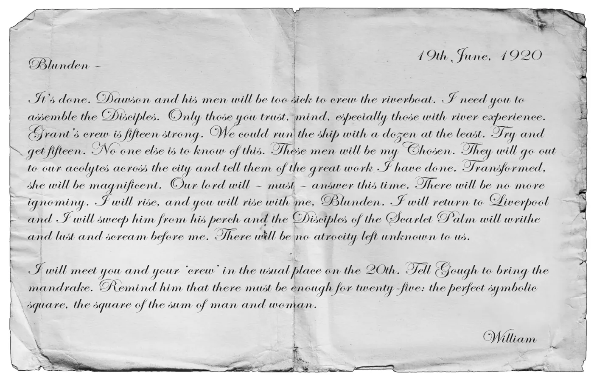

## Раздатки

### Раздатка 1: газетная вырезка

> **Раздатка «Ужас на Темзе» 1**
>
> **НОВЫЙ ОРЛЕАН НА ТЕМЗЕ**
>
> Как устоять перед такой новинкой? Настоящий пароход с Миссисипи, разобранный и доставленный к нашим берегам из Нового Орлеана, чтобы во всём великолепии плавать по Темзе, — всё по воле и на средства американского миллионера Таддеуса Гранта. Мистер Грант, чьи необычайные выходки так часто украшают эту колонку, сказал нашему корреспонденту: «Я хотел привезти немного сердечной романтики Дикси в этот великий город и на его великолепную реку. Я не мог придумать для этого ничего лучше красоты и величия одного из прекрасных речных пароходов Америки».
>
> Перестроенная и переоборудованная фирмой «Джон И. Торникрофт и Ко», переименованная «Луизианская леди» отправится в первый рейс 21 июня от Гринвичского пирса в блистательный круиз в день солнцестояния, увенчанный великолепным фейерверком у форта Коулхаус в Ист-Тилбери. Мистер Грант, неизменно любимый шумной лондонской молодёжью, обещал праздник солнцестояния на всю жизнь с отчётливо американским вкусом. Любопытно, многие ли из его гостей запомнят это событие до наступления 22-го.
>
> *«Сегодняшние сплетни: новости и мнения о мужчинах, женщинах и делах вообще», «Дейли миррор», суббота, 19 июня 1920 года*

### Раздатка 2: письмо Канлиффа капитану Джеймсу Бландену (каюта E)

> **Раздатка «Ужас на Темзе» 2**
>
> *19 июня 1920 года*
>
> Бланден —
>
> Дело сделано. Доусон и его люди будут слишком больны, чтобы вести пароход. Мне нужно, чтобы ты собрал Учеников. Только тех, кому доверяешь, понял, — особенно тех, кто знает реку. У Гранта команда в пятнадцать человек. Мы справились бы с судном и дюжиной. Постарайся набрать пятнадцать. Больше никто не должен об этом знать. Эти люди станут моими Избранными. Они пойдут к нашим приверженцам по всему городу и расскажут им о великом деле, которое я совершил. Преобразившись, она будет великолепна. Наш господин ответит — обязан ответить — на этот раз. Больше никакого позора. Я возвышусь, и ты возвысишься вместе со мной, Бланден. Я вернусь в Ливерпуль, сброшу его с насеста, и Ученики Алой Ладони будут корчиться, вожделеть и кричать предо мной. Не останется злодеяния, нам неведомого.
>
> Встречу тебя и твою «команду» в обычном месте 20-го. Скажи Гофу принести мандрагору. Напомни ему, что её должно хватить на двадцать пять: совершенный символический квадрат, квадрат суммы мужчины и женщины.
>
> *Уильям*
