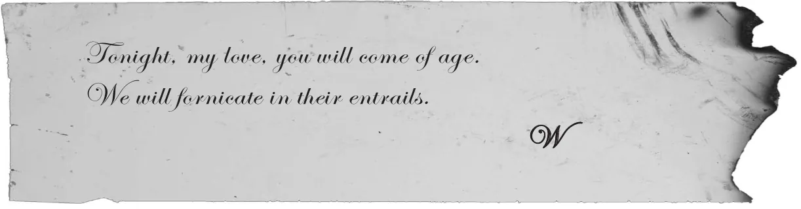
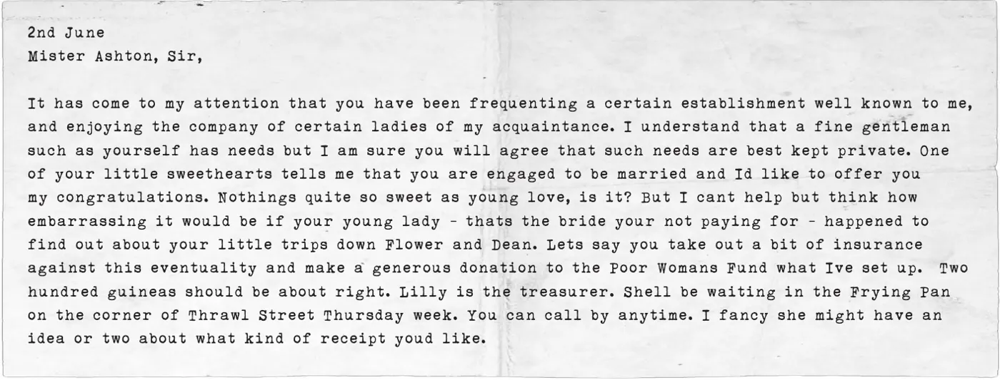
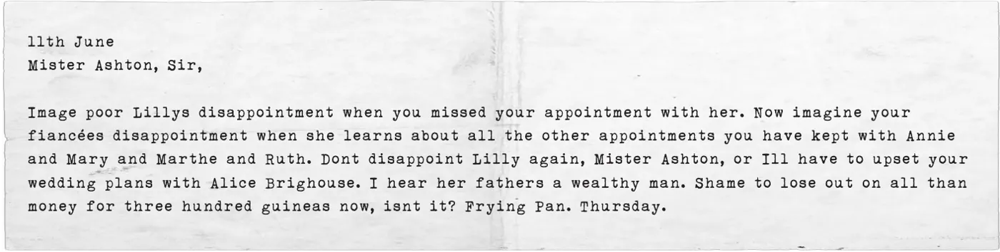
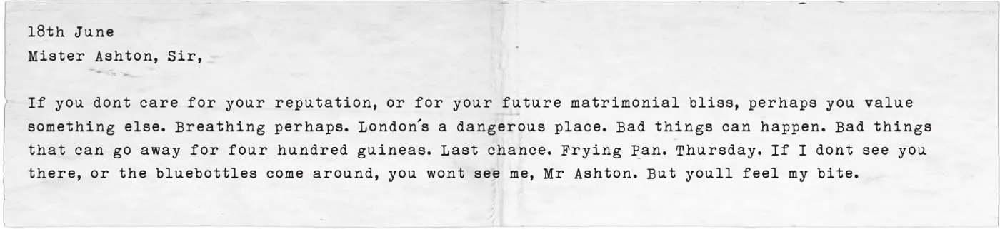

### Раздатка 3: надпись в открытке ко дню рождения (каюта 7)

> **Раздатка «Ужас на Темзе» 3**
>
> *Сегодня, любовь моя, ты станешь взрослой.*
>
> *Мы будем совокупляться в их потрохах.*
>
> *W*

### Раздатки 4, 5 и 6: шантажные письма, которые получил Лоуренс Эштон (каюта 8)

> **Раздатка «Ужас на Темзе» 4**
>
> 2 июня
>
> Мистер Эштон, сэр,
>
> Мне стало известно, что вы захаживаете в одно заведение, хорошо мне знакомое, и наслаждаетесь обществом кой-каких дамочек из моих знакомых. Я понимаю, что у такого прекрасного джентльмена, как вы, есть потребности, но уверен, вы согласитесь, что такие потребности лучше держать при себе. Одна из ваших милашек говорит мне, что вы помолвлены, и я хотел бы поздравить. Нет ничего слаще молодой любви, правда? Но никак не могу перестать думать, как неловко было бы, кабы ваша юная леди — та невеста, за которую вы не платите, — прознала про ваши прогулочки по Флауэр-энд-Дин. Скажем, вы застрахуетесь от этакого случая и сделаете щедрое пожертвование в Фонд бедных женщин, что я завёл. Двести гиней будет в самый раз. Лилли у нас казначей. Она будет ждать в «Сковороде» на углу Троул-стрит в четверг через неделю. Заходите когда угодно. Сдаётся мне, у неё найдётся мыслишка-другая насчёт того, какую вам выписать квитанцию.

<!-- -->

> **Раздатка «Ужас на Темзе» 5**
>
> 11 июня
>
> Мистер Эштон, сэр,
>
> Представьте, как огорчилась бедная Лилли, когда вы не пришли на встречу. А теперь представьте, как огорчится ваша невеста, когда узнает про все другие встречи, на которые вы ходили, — с Энни, и Мэри, и Мартой, и Рут. Не огорчайте Лилли снова, мистер Эштон, а то придётся мне расстроить вашу свадьбу с Элис Брайхаус. Слыхал я, её папаша богатый человек. Жалко упустить все эти деньги из-за трёхсот гиней, а? «Сковорода». Четверг.

<!-- -->

> **Раздатка «Ужас на Темзе» 6**
>
> 18 июня
>
> Мистер Эштон, сэр,
>
> Если вам плевать на свою репутацию или на будущее семейное счастье, может, вы цените что-то другое. Дышать, например. Лондон — опасное место. Тут случаются дурные вещи. Дурные вещи, которые могут уйти за четыреста гиней. Последний шанс. «Сковорода». Четверг. Если я не увижу вас там или заявятся легавые, вы меня не увидите, мистер Эштон. Но мой укус почувствуете.
