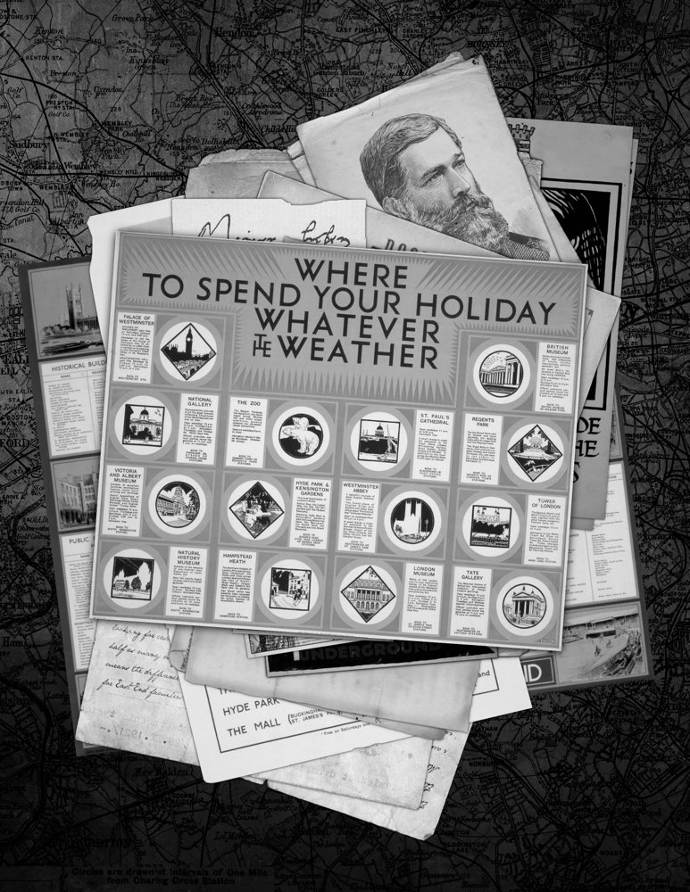

*Полностраничная заставка без текста: плакат лондонской подземки «Где провести выходной в любую погоду» (Вестминстерский дворец, Национальная галерея, зоопарк, собор Святого Павла, Риджентс-парк, Музей Виктории и Альберта, Гайд-парк и Кенсингтонские сады, Вестминстерское аббатство, Тауэр, Музей естествознания, Хэмпстед-Хит, Лондонский музей, галерея Тейт, Британский музей) поверх писем, гравюры с бородатым мужчиной и старой карты Лондона.*
