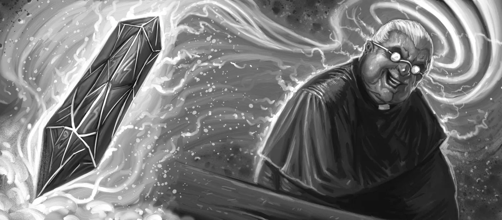

```stat
Преподобный Альберт Ли
41 год, порочный священник

СИЛ 60    ВЫН 50    ТЕЛ 60    ИНТ 65
МОЩ 110   ЛВК 53    НАР 55    ОБР 65
ПЗ 11     БкУ 0     Комплекция 0    Скорость: 7
Рассудок: 0

Атаки: Драка 40% (20/8), урон 1d3
       Уклонение 30% (15/6)

Навыки: Обаяние 40%, Средства 55%, Мифы Ктулху 15%, Запугивание 70%, Оккультизм 70%, Убеждение 60%.

Заклинания: Слова власти, Мысленное внушение, Покорение, Затуманить память, Взрыв мозга, Общее наваждение беспечного разума (см. предыдущую страницу).
```

**Тайны и цели:** Ли разрывается надвое. Он чувствует вину, но продолжает вредить людям в погоне за властью. Он нашёл магические врата в другое измерение, известное как Великое белое пространство, и выполняет приказы обитающих там «ангелов» (Старцев). Пережитое в Великом белом пространстве сломило его разум. Настоящего плана у него теперь нет, но он будет и дальше развращать людей и распространять влияние Старцев.

**Как играть преподобного Ли:** всегда старайтесь обратить положение себе на пользу. Он может быть обаятельным или суровым — смотря что ему нужно.

### Христаллум

Христаллум — кусок тёмного кристалла или стекла величиной с ладонь. Его многочисленные грани явно огранены и отполированы. Если поднять его к свету, видно, что он фиолетовый. Если смотреть в глубину Христаллума несколько минут, начинаешь слышать звук. Звук нарастает, пока не становятся различимы странные слова. Если человек касается Христаллума, слова громко стучат у него в голове.

Кроме того, Христаллум служит вместилищем для 100 магических пунктов, которыми Ли может пользоваться на расстоянии: для этого ему не нужно держать кристалл при себе. В начале игры в нём 70 магических пунктов. Ли может по желанию вкладывать в Христаллум собственные магические пункты.

Христаллумом пользовался Эдвард Келли. Он постиг енохианский язык и записывал часть услышанного для доктора Джона Ди. Записанное он менял к своей выгоде, и потому тайны языка оказались запутаны.



#### Енохианский язык

Енохианский — язык ангелов. Говорят, по Книге Бытия, Бог говорил на енохианском языке, обращаясь к Адаму и Еве. Этот язык был
