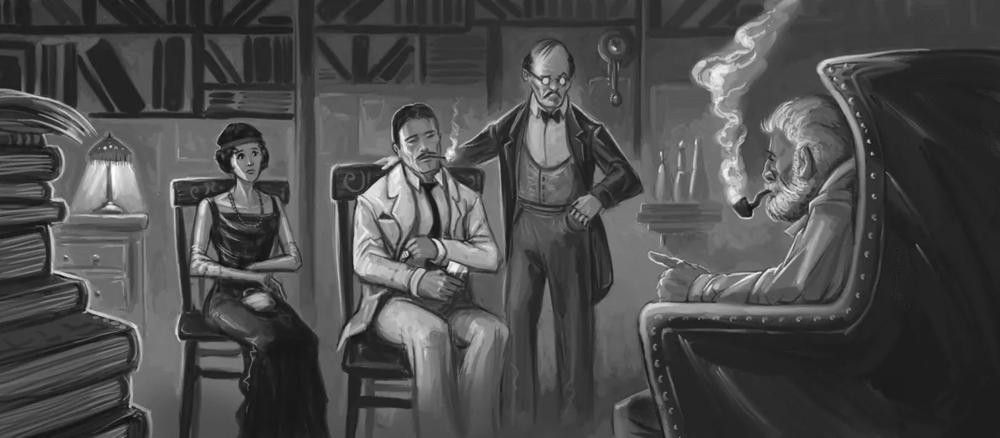

Церковь преподобного Ли посещают самые разные люди. Одни богаты, другие служат у богатых хозяев. У некоторых из этих богачей есть частные библиотеки с ценными томами, которые интересуют преподобного Ли.

С помощью кода он может заставлять прихожан красть для него избранные тома. Вору велено забыть о том, что он сделал. Чаще всего кражу замечают не сразу, а когда замечают, виновного трудно найти. Даже если виновного каким-то образом находят, он не может вспомнить, куда отнёс украденное. Его кажущуюся забывчивость обычно ошибочно принимают за обман.

## Сыщики

Сыщиков вызывает дядя умершей молодой женщины. Лучше всего для этого сценария подойдёт группа сыщиков, связанная с полицией, или частные детективы, — сценарий написан именно с расчётом на это.

### Начало: встреча с Лайонелом

Игра начинается с того, что Лайонел Галлан зовёт сыщиков расследовать смерть его племянницы Элис Доу, скончавшейся вчера.

#### Лайонел Галлан

Лайонел Галлан — брат матери Элис Доу. Лайонел живёт затворником среди своих книг и кошек. У него есть кое-какие вложения, которые приносят умеренный доход, и, если не считать покупки редких книг, живёт он скромно. Он глубоко опечален смертью племянницы, которая регулярно его навещала, — в последний раз накануне своей смерти. Во время этого визита он поймал её на краже одной из своих книг. Когда он призвал её к ответу, она, казалось, не сознавала, что взяла книгу, — будто была во сне. Происшествие озадачило Лайонела и пристыдило Элис. Она поспешно ушла. Больше Лайонел её не видел.

Речь о книге «Liber de Lumine» («Книга света») Рамона Луллия. Она написана в 1283 году, а этот экземпляр напечатан в Милане в 1827 году. Говорят, Луллий получал свои книги по божественному вдохновению. Возможно, он слышал шёпот голосов Старцев.

Лайонел не знает, что Элис украла ещё одну книгу. В его доме такой беспорядок, что, даже хватись он какой-нибудь определённой книги, он просто рассердился бы и досадовал на себя, решив, что куда-то её задевал.

Вчера вечером к Лайонелу заходила доктор Бэнкс — врач, констатировавшая смерть его племянницы. За стаканом виски они обсудили её беду. Бэнкс доверительно сообщила, что девушка умерла не от осложнений выкидыша, но полиция, скорее всего, удовлетворится этим простым объяснением.

