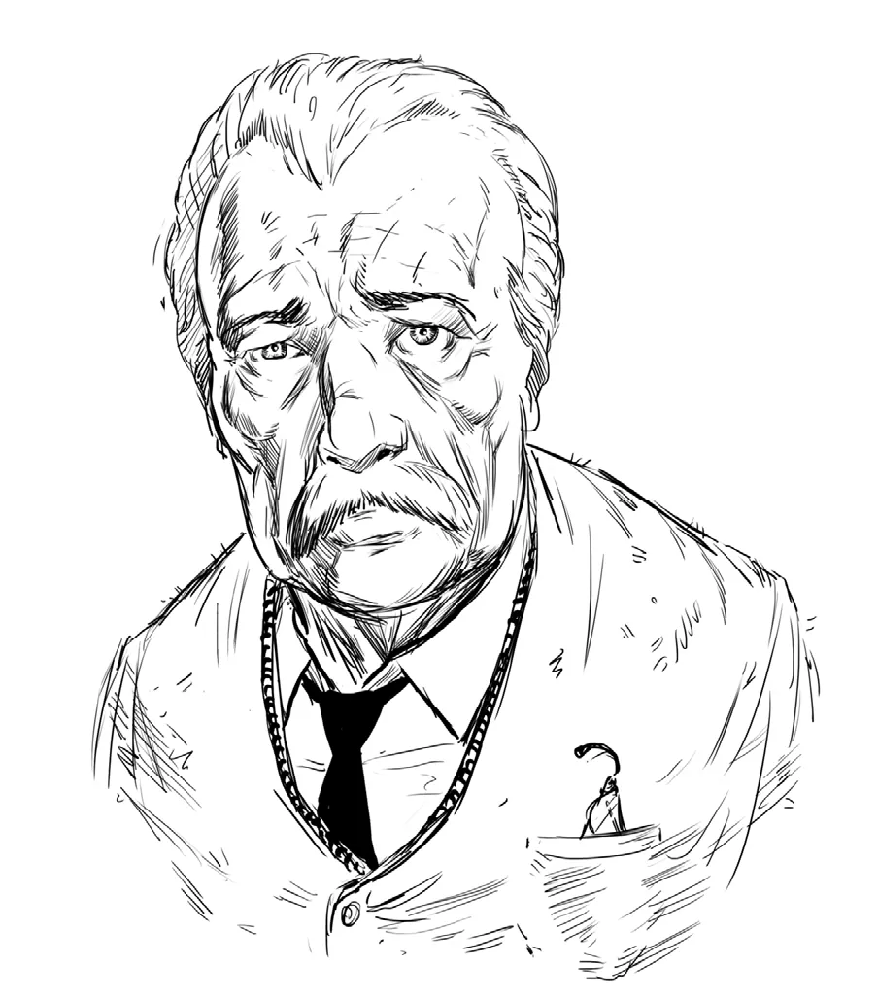

Лайонел подозревает, что тот, от кого забеременела его племянница, как-то ею управлял, и просит сыщиков выяснить, что происходило и кто виноват. Он предлагает заплатить их обычный гонорар за такую работу. Если настаивать на подробностях смерти племянницы, он делает большой глоток виски и отсылает сыщиков к доктору Бэнкс.



```stat
Лайонел Галлан
46 лет, дядя-затворник

СИЛ 50    ВЫН 60    ТЕЛ 55    ИНТ 75
МОЩ 60    ЛВК 62    НАР 50    ОБР 70
ПЗ 11     БкУ 0     Комплекция 0    Скорость: 7
Рассудок: 60

Атаки: Драка 25% (12/5), урон 1d3
       Уклонение 31% (15/6)

Навыки: Средства 45%, Оккультизм 40%, История 60%.
```

**Внешность:** Лайонел худ, волосы у него редеют. У него бледное лицо человека, избегающего солнца.

**Тайны и цели:** Лайонел искренне любит племянницу. Если он узнает, кто виновен в её смерти, он постарается свершить правосудие с помощью верёвки.

**Как играть Лайонела:** он скорбит о племяннице и может бурно выражать чувства (ярость или горе).

После вступительной сцены игроки, скорее всего, отправятся либо к доктору Бэнкс, либо в дом семьи Элис.

### Дом семьи Доу

Семья Доу живёт на третьем этаже современного дома рядовой застройки на Брюхаус-Ярд в Финсбери. Каждый этаж сдаётся отдельной семье. Всего в доме четыре этажа, считая подвал. Жильё простое, но чистое и уютное. Недавние события бросили мрачную тень на дом и его обитателей.

*Прим. перев.: в оригинале «second story» — по британскому счёту второй этаж над первым, то есть третий по-русски.*

#### Миссис Дороти Доу

Миссис Доу, 44 года, — худая темноволосая женщина в чёрном. Она ведёт хозяйство и смотрит за детьми. Старшая сестра Элис замужем и живёт отдельно. Элис раньше доверилась матери, что беременна. Дороти знала, что дочь встречается с Сесилом Боско (см. ниже), и ожидала, что они скоро поженятся. Девушка не подтвердила и не отрицала, что отец — этот парень. Настоящей причины своей беременности (преподобного Ли) она не помнила. Если игроки будут обходиться с Дороти уважительно и пообещают не говорить об этом её мужу, Дороти доверит им имя Сесила.

#### Мистер Бартоломью Доу

Мистер Доу, 43 года, — конторщик в местной бухгалтерской конторе. Лицо у него осунувшееся, одежда висит на худом теле. Он жаждет узнать, кто был любовником Элис, и находит некоторое утешение в мечтах о мести. Он не знает, что ответ на этот вопрос известен его жене. Он попросит сыщиков пообещать, что они назовут ему имя, если узнают его.

#### Джетро и Артур Доу

Двое младших братьев Элис живут в одной спальне. У Джетро есть книга, и он клянётся, что её дала ему Элис. Это неправда: он нашёл книгу в кармане пальто Элис. Некоторые страницы он раскрасил восковыми мелками.

Книга — том в четвертьпереплёте из пергамента под названием «Алхимические сочинения Эдварда Келли», датированный 1893 годом. Подробнее об Эдварде Келли игроки могут узнать в любой хорошей библиотеке или разговорив на эту тему Лайонела.
