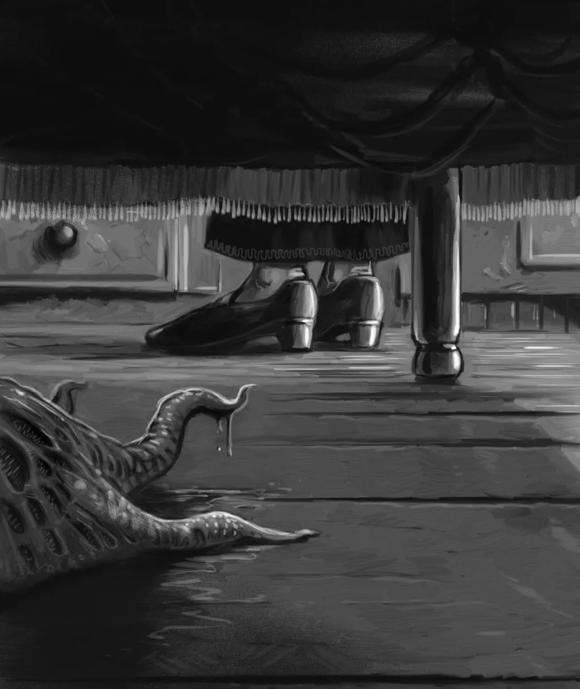

Любой из этих путей даёт **раздатку 1: Эдвард Келли**. Сама книга — перевод нескольких других сочинений (датированных 1676 годом), часть которых написана в тюрьме и посвящена Рудольфу II (императору Германии). Это оккультный труд об алхимии и тайнах философского камня; часть этих знаний будто бы поведали Келли ангелы. Изучение книги займёт несколько дней и даёт Оккультизм +2 (без потери Рассудка). Когда в игре всплывёт имя Эдварда Келли, попросите пройти трудные проверки ОБР. При успехе персонаж вспоминает историю о доме, где в прошлом году будто бы были слышны ангелы (см. **«Дом Креспо»**).

#### Покойная Элис Доу

Элис Доу было 17 лет, она работала швеёй. Она с радостью согласилась, когда преподобный Ли пригласил её встретиться с ним в церкви. К счастью, она не знала о тех часах, что они провели вместе в склепе. Ли затуманил её память кодом. Она забеременела от Ли, не подозревая, что её целомудрие хоть раз было нарушено. Побочным действием кода, которому она подверглась, стали маленькие пушистые пёрышки, растущие у Элис на лопатках.

Констебля Уилкинса вызвали около рассвета 3 февраля 1924 года. Молодая женщина, лежавшая среди пропитанных кровью простыней, была явно мертва. Уилкинс как мог успокаивал семью до прихода врача. Он воспользовался этим временем, чтобы расспросить обезумевших от горя родных, но безрезультатно. Узнав от матери, что девушка была беременна, он поспешил заключить, что смерть — следствие тяжёлого выкидыша.

Если игроки тщательно обыскивают комнату Элис, попросите пройти проверки Внимания:

- При обычном успехе они находят суперобложку от книги.
- При трудном успехе — суперобложку и кольцо.
- При чрезвычайном успехе — суперобложку, кольцо и отродье.

#### Суперобложка

Суперобложка спрятана в кармане пальто Элис. На ней от руки чернилами написано название книги (почерком Лайонела). Она соскочила, когда Джетро вынул книгу из кармана. Книга теперь у Джетро. Этот тонкий том был украден из собрания её дяди. Элис умерла, не успев передать книгу преподобному Ли.

#### Кольцо

Кольцо спрятано в ящике. Если присмотреться, на его внутренней стороне вырезаны три черты, которые могут складываться в букву «A». Кольцо подарил Элис Сесил Боско, и оно ему очень дорого как память.

#### Отродье

Существо, нанёсшее ей рану, — отродье преподобного Ли — ночью забеспокоилось и начало прогрызать себе путь на волю. Девушка думала, что боль пройдёт, и молчала, боясь гнева отца, если он узнает о беременности. Вскоре она потеряла сознание от внутреннего кровотечения, когда отродье перерезало ей аорту. Насытившись артериальной кровью, тварь почувствовала, что жизнь покидает её носительницу. Тогда она прогрызла себе выход из её живота и укрылась под кроватью.

*Прим. перев.: здесь отродье выходит из живота, а на с. 54 рана названа «на пояснице» — так в оригинале.*

Передвигается оно бесшумно, ползком. Оно предпочитает спящих и старается коснуться кожи жертвы. Затем оно выделяет обезболивающую жидкость из своей шипастой нижней стороны, что позволяет ему прицепиться, не потревожив носителя. Прицепившись, оно кусает и кормится. Оно умеет сворачивать кровь так, что жертва может и не заметить укуса. Такую атаку можно сравнить с укусом клеща. Атака причиняет 1d3 урона. Проснувшись, человек заметит рану при успешной проверке Внимания.
