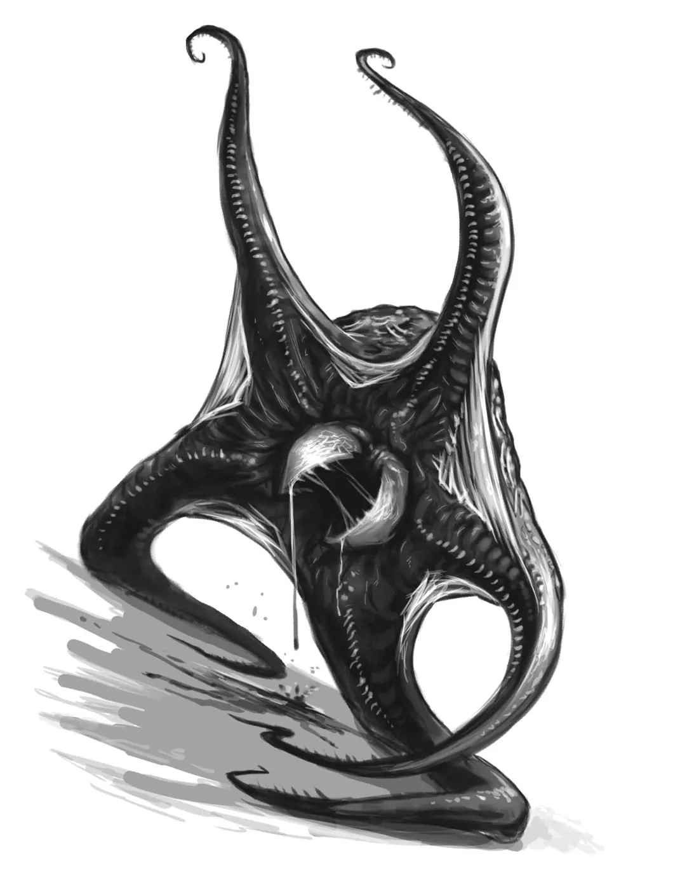

Или же оно может вбуравиться в носителя и укрыться в нём, оставив маленькую ранку около сантиметра в поперечнике. Носители отродья очень восприимчивы к влиянию Старцев и одержимости ими.

Отродье не нападает на Ли и на тех, кто уже носит в себе другое отродье.

**Описание:** отродье похоже на жёлтую морскую звезду. У него пять лучей, а величиной оно с мужскую ладонь. Нижняя сторона покрыта крошечными шипами, окружающими клюв в центре.



```stat
Отродье

СИЛ 20    ВЫН 50    ТЕЛ 10    ИНТ 20
МОЩ 80    ЛВК 42    ПЗ 6      Комплекция −2
Скорость: 4      БкУ −2

Атаки: особые (см. описание).
       Уклонение 21% (10/4)

Потеря Рассудка: 0/1d4 за то, чтобы увидеть отродье.
```

*Прим. перев.: Скорость 4 — как в оригинале; по характеристикам выходит 9, но малая скорость существа величиной с ладонь, видимо, задумана.*

#### Визит преподобного

Среди тех, кто навещает скорбящую семью на следующий день после смерти Элис, — преподобный Ли. Семья принадлежит к его пастве, так что визит ожидаем. Если суперобложка всё ещё в комнате Элис, преподобный найдёт её и станет искать книгу. Если книга всё ещё у Джетро, Ли запугиванием отберёт её. После этого Джетро будет расстроен и растерян. Если отродье всё ещё здесь, его потянет к преподобному, но на него набросится собака семьи. Преподобный изобразит ужас при виде твари, теперь изжёванной и разорванной собачьими зубами. Преподобный будет осторожен и не сделает ничего, что вызвало бы подозрения игроков.

#### Сесил Боско, возлюбленный покойной Элис Доу

Возлюбленный Элис, Сесил Боско, — семнадцатилетний подмастерье местного портного по фамилии Хоукинс. Известие о смерти Элис приведёт Сесила в отчаяние. Близости между ними никогда не было. Если он узнает, что она была беременна, к его горю лишь прибавятся обида и смятение. Недавно Элис заговорила о свадьбе, и Сесил подарил ей кольцо своей покойной бабушки. Он будет умолять сыщиков вернуть кольцо в целости. Сесил и кольцо — по большей части ложный след, но они могут снова привести сыщиков в дом Доу.

### Расспросы констебля Уилкинса

Уилкинс — честный, трудолюбивый полицейский, которому небезразличны жители его участка. Прежде чем говорить с сыщиками, он захочет узнать их имена и полномочия. Если у сыщиков нет официального статуса, чтобы он поделился хоть какими-то сведениями, нужна подходящая проверка навыка (Красноречия, Убеждения, Запугивания или Обаяния).

На вопросы об Элис он может рассказать факты, какими их знает. Он считает, что девушка умерла от какого-то осложнения после выкидыша. Подробнее об этом он отправит сыщиков к доктору Бэнкс. Он много лет знает семью Доу и каждое воскресенье видит их в церкви.

Если речь зайдёт о краже книги, он упомянет о краже другой книги из переплётной мастерской Маклаглена несколько дней назад.

Об отродье Уилкинс ничего не знает и, если обратить на него его внимание, будет озадачен и не поверит.
