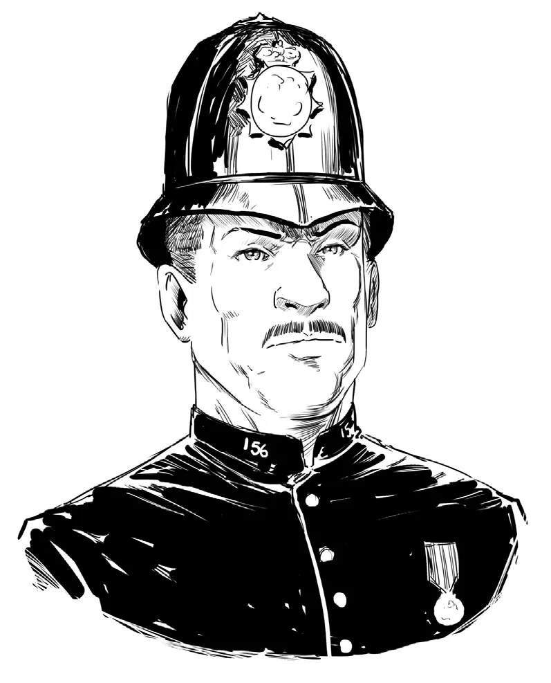
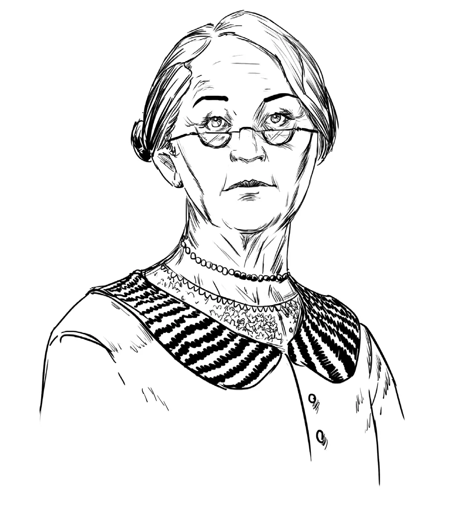

#### Констебль Уилкинс

**Внешность:** у Уилкинса тёмные пронзительные глаза; в своей щегольской форме он выглядит внушительно.

**Тайны и цели:** однажды он застал преподобного Ли на месте преступления, но с помощью заклинания «Затуманить память» его заставили забыть об этом. В драке или споре он встанет на сторону преподобного.

**Как играть Уилкинса:** подозреваются все — пристально смотрите на собеседников и кивайте, пока они говорят. Уточняйте сказанное: пересказывайте его своими словами и возвращайте говорящему для подтверждения.



```stat
Констебль Уилкинс
26 лет, полицейский, не задающий вопросов

СИЛ 70    ВЫН 60    ТЕЛ 75    ИНТ 55
МОЩ 45    ЛВК 67    НАР 60    ОБР 60
ПЗ 13     БкУ +1d4  Комплекция +1   Скорость: 7
Рассудок: 40

Атаки: Драка 45% (22/9), урон 1d3 + 1d4
       Дубинка 45% (22/9), урон 1d6 + 1d4
       Уклонение 50% (25/10)

Навыки: Средства 25%, Оккультизм 40%, Юриспруденция 55%, Запугивание 65%, Убеждение 40%.
```

### Визит к доктору Бэнкс

Доктор Бэнкс первой осмотрела тело Элис. Она быстро нашла рану на пояснице девушки. Рана находится между грудной клеткой и тазом, около 4 сантиметров в поперечнике — примерно с кольцо, которое получится, если соединить кончик указательного пальца с кончиком большого. Края раны рваные, и, похоже, части плоти не хватает.

*Прим. перев.: здесь рана «на пояснице», а на с. 52 отродье выходит из живота — так в оригинале.*

В тот же день (4-го) доктор проведёт вскрытие и будет потрясена, увидев следы того, что нечто изгрызло тело изнутри. Доктор ошибочно предполагает, что в девушку прогрызлась крыса и съела её нерождённого ребёнка. Объяснение крайне маловероятное, но оно лучше того, что теперь преследует доктора Бэнкс каждую минуту бодрствования: что нерождённый ребёнок выел себе путь из матери.



Если доктора расспрашивать, она настоит на том, чтобы показать сыщикам труп (Рассудок 0/1d3), и будет умолять их сказать, что могло такое сотворить. Затем она показывает им второе тело — Мэри Хеймер, которая, по-видимому, умерла так же. Доктор не знает, что звездообразное отродье, выбравшееся из тела Мэри Хеймер, 26 января поселилось в её собственном животе.

#### Доктор Эдит Бэнкс

**Внешность:** одета в твидовую юбку и жакет, волосы стянуты в пучок. Эдит смотрит на людей поверх очков-половинок.
