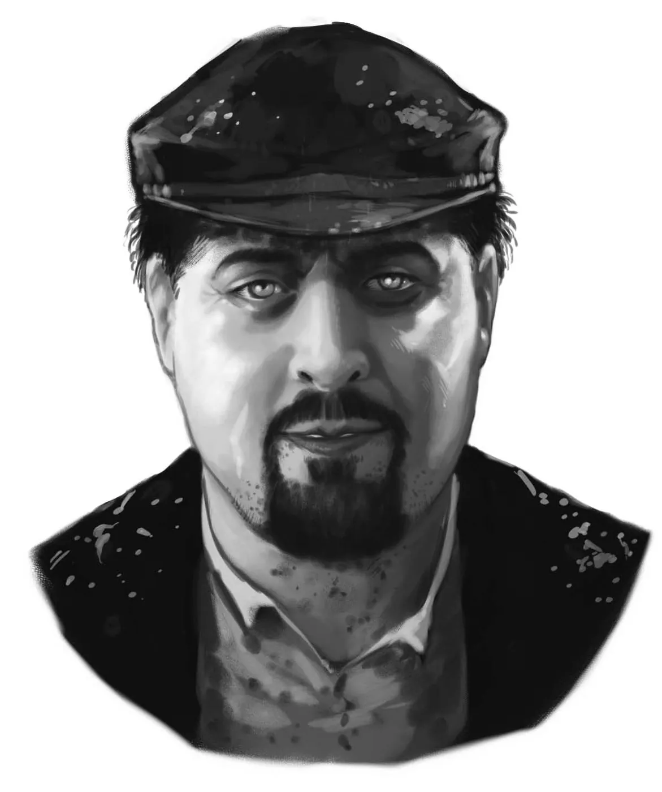

разбирает учение о prisca theologia («древнейшем богословии»), утверждая, что во всех религиях заключена одна истина, данная человеку высшей силой в далёком прошлом.

На беду Эрика, когда он уходил, мистер Юарт как раз возвращался домой, и они столкнулись в прихожей. Юарт заметил, что Эрик что-то прячет, и началась погоня. Юарт настиг Эрика на Фаррингдон-роуд. Эрик выхватил из кармана металлический скребок для краски и ударил Юарта в горло. Юарт умер, стоя на коленях, захлёбываясь собственной кровью, а вокруг собиралась толпа.

Можно сделать так, чтобы сыщики увидели нападение и пустились в погоню. Из этого выйдет отличная сцена погони по оживлённым вечерним улицам, где полно людей, возвращающихся с работы, уличных торговцев, автомобилей, автобусов и так далее. Эрик направится к церкви Святого Иакова. Преподобный Ли не обрадуется ему, если тот приведёт за собой неприятности.



#### Эрик Бёрджесс

**Внешность:** Эрик одет в синюю рабочую одежду, на лице у него мазки белой краски.

**Тайны и цели:** Эрик ни перед чем не остановится, чтобы донести книгу до церкви, где попытается передать её преподобному Ли.

```stat
Эрик Бёрджесс
27 лет, отчаявшийся маляр-декоратор

СИЛ 65    ВЫН 65    ТЕЛ 60    ИНТ 45
МОЩ 65    ЛВК 77    НАР 70    ОБР 40
ПЗ 12     БкУ +1d4  Комплекция +1   Скорость: 9
Рассудок: 65

Атаки: Драка 40% (20/8), урон 1d3 + 1d4
       Уклонение 40% (20/8)

Навыки: Искусство/ремесло (маляр-декоратор) 65%, Лазание 60%, Средства 10%, Скрытность 40%.
```

### Семья Креспо

Семья Креспо — итальянского происхождения. Мистер Креспо купил свой дом, когда стал конторщиком в Финсберийском сберегательном банке на Секфорд-стрит. У мистера и миссис Креспо пятеро детей, и они держат горничную. Вся семья регулярно ходит в церковь Святого Петра на Клеркенуэлл-роуд — католическую церковь, любимую местной итальянской общиной.

Джованни Креспо (37 лет) — стройный темноволосый джентльмен с хорошими манерами. Он очень радушен к гостям и всегда рад распить бутылку вина. Его жена Габриэлла (33 года) серьёзна и гордится своим хозяйством. Если кто-то из детей расшалится, она утихомиривает его одним взглядом. Дети — Чезаре (1 год), Доменико (3 года), Эрменеджильдо (4 года), Ренато (7 лет) и Антонио (9 лет) — непрестанно отвлекают и вносят суету в дом Креспо.

*Прим. перев.: в оригинале у Креспо «пятеро детей» и названы пятеро сыновей, а на с. 57 упомянута ещё одиннадцатилетняя дочь Джана; так в оригинале.*

#### Дом Креспо

История дома Креспо — фон событий этого сценария. Старый дом в Клеркенуэлле очень похож на соседние. Сыщики могут побывать в нём в середине сценария, собирая сведения о преподобном Ли, или позже, когда заболеет горничная Креспо, София.

Креспо не знают, что когда-то в их доме жил Эдвард Келли (примечание: нет никаких свидетельств, что Келли жил в этом доме, — это выдумка для данного сценария). Живя в этом доме, он занимался оккультными изысканиями вместе с доктором Джоном Ди. Обязанности Келли вынуждали его
