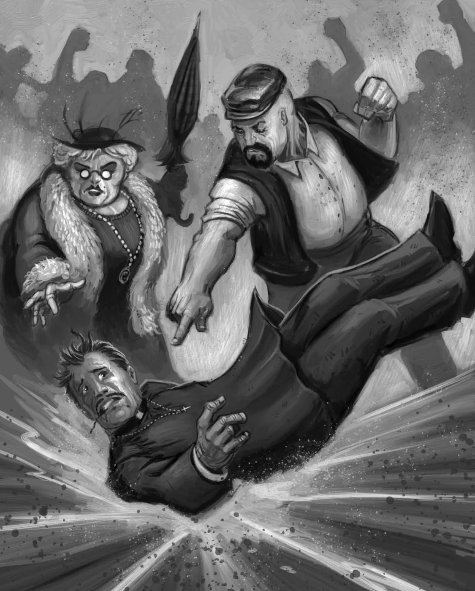

положением священнослужителя, он смог поговорить с девушкой и применить к ней код. Прежде она не ходила в церковь регулярно, но с того времени стала постоянной прихожанкой церкви Святого Иакова. Дальнейшая её судьба почти такая же, как у Элис, Мэри и целого ряда других. Физических побочных эффектов кода у Софии нет, но она начала видеть то, что можно было бы назвать человеческими аурами (миссис Креспо может это подтвердить).

5 февраля София падает без чувств в доме Креспо. Миссис Креспо пытается ухаживать за Софией и вызывает семейного врача, доктора Пезавенто. В животе у Софии живёт выводок отродий; они активны, но ею не питаются. Поэтому её живот шевелится и подёргивается самым тревожным образом. Если кто-нибудь положит руку ей на живот, он почувствует, как там что-то движется. Видеть это — значит пройти проверку Рассудка (Рассудок 0/1d3).

Доктор Пезавенто узнает симптомы и свяжет их со случаями доктора Бэнкс (о которых до него доходили слухи). Он тут же вызовет доктора Бэнкс. Позже Софию можно привести в сознание и расспросить. Если спросить её о времени, проведённом с преподобным Ли, она растеряется, а если настаивать — впадёт в истерику. В какой-то момент в тот же день, когда это будет уместнее всего, живот Софии лопнет, и из него вырвутся шесть отродий, каждое из которых жаждет нового носителя.

Миссис Креспо может рассказать сыщикам, что София была очень старательной служанкой. Её тревожит, кто теперь будет ухаживать за больной матерью Софии. Ещё она обмолвится, что ходить в церковь Софию уговорил викарий, которого та случайно встретила по дороге домой однажды в ноябре прошлого года. Миссис Креспо — католичка, и, хотя она одобряет религиозность, ей было бы приятнее, если бы София ходила в католическую церковь.

### Нападение на преподобного Миллера

Когда преподобный Смит ушёл на покой, на его место, работать бок о бок с преподобным Ли, прислали молодого викария. Они разные, как небо и земля. Новый викарий, преподобный Миллер, — жизнерадостный и сострадательный молодой человек.

По мере того как преподобный Ли всё лучше владеет кодом, он с его помощью настраивает паству против преподобного Миллера. В следующие дни дети на улице осыпают преподобного Миллера бранью, какая-то женщина бросает в него яйцом, а его велосипед находят разбитым так, что не починить.

Когда средь бела дня он идёт в местную лавку, на него набрасывается разгневанная старуха. Расспрошенная потом, она не может толком сказать, на что так рассердилась, — только что викарий что-то сделал. Преподобный Миллер пытался успокоить женщину, но чем больше старался, тем больше она злилась, привлекая внимание небольшой толпы. Двое мужчин вышли из соседнего паба и начали толкать викария. Казалось, они воображали себя доблестными рыцарями, защищающими даму от какого-то разбойника. Потом всё обернулось скверно. Преподобный Миллер в панике попытался бежать, но толпа схватила его. Когда он упал, толпа набросилась на его слабое молодое тело, распростёртое на твёрдой земле. Они рвали на нём одежду и молотили его ногами в башмаках, пока кости не раскололись, а череп не проломился. Даже прибывшей полиции было трудно разогнать толпу — так глубоко её охватила первобытная жажда крови.

Сыщики должны стать свидетелями этого нападения. Точное время и место нападения можно выбрать так, чтобы сцена произвела наибольшее впечатление. Если персонажи игроков вмешаются, дело кончится чем-то вроде кабацкой драки. Нападать на них будут,
