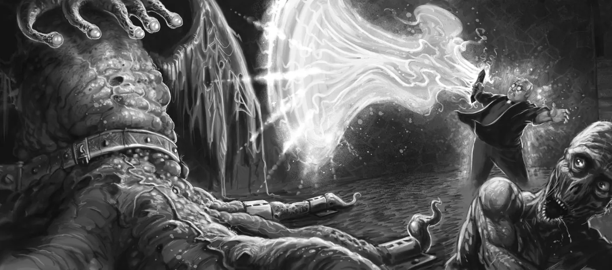

**Тайны и цели:** она полностью порабощена преподобным Ли.

**Как играть миссис Стэнхоуп:** улыбайтесь губами, но не глазами. Говорите довольно ровным, бесцветным голосом.

```stat
Миссис Эмили Стэнхоуп
56 лет, несчастная экономка

СИЛ 75    ВЫН 65    ТЕЛ 70    ИНТ 50
МОЩ 50    ЛВК 62    НАР 45    ОБР 40
ПЗ 13     БкУ +1d4  Комплекция +1   Скорость: 6
Рассудок: 40

Атаки: Драка 35% (17/7), урон 1d3 + 1d4
       Чугунная сковорода 35% (17/7), урон 1d6 + 1d4
       Уклонение 34% (17/6)

Навыки: Средства 15%, Убеждение 40%.
```

#### Подвал

Если Ли с помощью Христаллума перенёс врата в Великое белое пространство, они будут в подвале приората. Миссис Стэнхоуп строго велено никого не впускать, и она любыми средствами не даст никому войти.

### Церковь Святого Иакова

Церковь стоит среди окружающих её садов на Клеркенуэлл-Клоуз в Финсбери. Она относится к традиции «низкой церкви», следующей более простому, протестантскому подходу к богослужению. Церковь перестроена в 1792 году; первоначальная церковь восходит к 1540 году, а ещё раньше на этом месте был женский монастырь. Прекрасная башня со шпилем гордо возвышается над лондонскими улицами. В церкви есть великолепный орган и набор из восьми колоколов. Престол для причастия — часть первоначального убранства церкви: он сделан из красного дерева и украшен инкрустацией в виде перьев и голубя — символа Святого Духа. Для символичности его можно описать как ангела, а не голубя.

#### Склеп

Склеп, где прежде хоронили, теперь представляет собой большой зал под церковью. Ключ от прочной деревянной двери — единственного входа в склеп — преподобный Ли всегда носит при себе. Дверь (СИЛ 180) сделана очень добротно. Успешная проверка навыка Взлома откроет дверь. От двери вниз ведёт каменная лестница. Если врата в склепе, яркий белый свет будет виден, как только откроют дверь.

Врата в Великое белое пространство будут посреди склепа, если только Ли не перенёс их в другое место с помощью Христаллума. Здесь же находятся Старец и Эдвард Келли.


