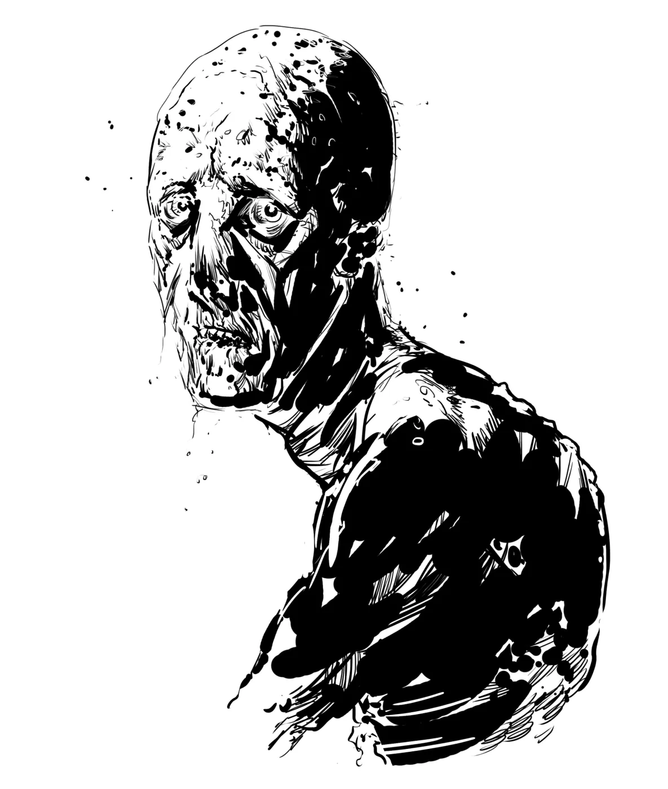

#### Старец в склепе

Преподобный Ли (или Кардью, как его, возможно, теперь зовут) силой Христаллума и владением кодом вызвал Старца из глубин антарктических льдов. Пока существо было ещё заморожено и спало, он нанял двух рабочих (обоих он подчинил себе кодом), чтобы приковать Старца в склепе. В крыльях просверлили отверстия, а к телу и щупальцам прикрепили металлические оковы. Оковы вделали в пол склепа. Ослабленный Старец держится в плену (его характеристики — в «Книге хранителя „Зова Ктулху“»).

Допрашивая Старца, преподобный Ли узнал о Великом белом пространстве — полумистическом месте, которое Старцы почитают. Когда-то, до прихода на Землю, Старцы могли входить в Великое белое пространство по своей воле. Это было место тайны и чуда, где Старцы могли парить и общаться друг с другом и с космосом. По какой-то причине, оказавшись запертыми на Земле, они утратили связь с Великим белым пространством. Некоторые Старцы считают, что этим, возможно, объясняется упадок и гибель их расы здесь, на Земле. Ли узнаёт эту историю, но, воспринимая её через призму христианства, понимает Великое белое пространство как христианский рай. Для него Старец — ангел. Ему кажется вполне логичным, что тот пал на Землю и больше не может вернуться домой. Ли убеждён, что нашёл чёрный ход в рай.

Старец отчаянно хочет вырваться и, если представится случай, сбежит через врата в Великое белое пространство. Разумеется, он не упустит случая отомстить Ли, если такая возможность выпадет. Есть шанс, что сыщикам удастся заключить со Старцем временный союз. Это, конечно, будет похоже на пресловутую «сделку с дьяволом». Старцы видят в людях своих рабов — нечто среднее между паразитами и движимым имуществом.

Старец удерживается посреди зала множеством цепей, прикреплённых к металлическим кольцам в полу. Он накрыт простынями и лишь слегка шевелится. На полу вокруг него нарисованы магические знаки. Проверка Оккультизма покажет, что это защитные символы. Вместе цепи и магические символы удерживают Старца ослабленным и связанным. Однако символы нужно обновлять каждый день. Если преподобный Ли ежедневно не тратит на сковывающую магию 5 магических пунктов, Старец вырвется на свободу.

#### Эдвард Келли

В склепе прячется дряхлое существо — Келли. Ли время от времени с удовольствием мучает Келли.

Веками Эдвард Келли стоял на страже в пылающих вратах в Великое белое пространство. Его тело опалило пламя, а разум терзали боль и насмешливые голоса Старцев. Ли вступил в общение с Эдвардом Келли и обманом заставил его покинуть свой пост в магических вратах. Ли выжег на груди Келли енохианские руны, которые не дают Келли снова войти во врата.

Келли безумен и может предлагать безумные планы уничтожения врат — с помощью головы Ли, Христаллума, сотни дохлых кошек и ведра крови. Верить ли его плану — решать игрокам. План не сработает.

**Внешность:** тело Келли истощено и обуглено. У него тревожащий взгляд человека, который видел, как проходят века, из темницы пламени. Уши у него обрезаны — так в его время метили воров.

**Тайны и цели:** в минуты просветления Келли будет умолять сыщиков убить Ли и запечатать врата.

**Как играть Келли:** он совершенно безумен, но бывают у него и минуты просветления.
