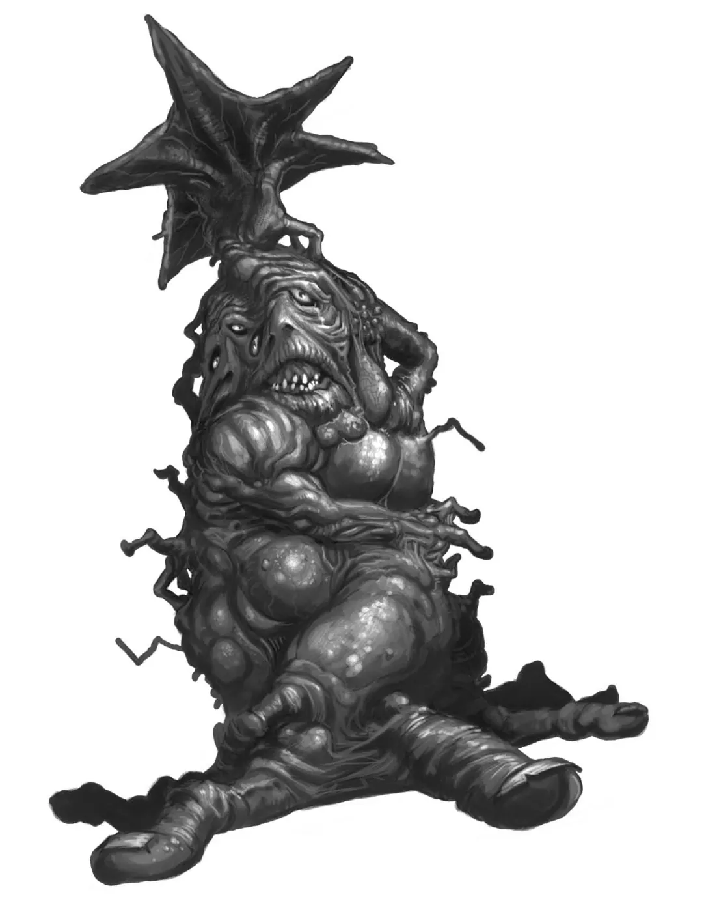

#### Старец

Старцы в Великом белом пространстве по какой-то причине не могут войти во врата. Однако сквозь врата они могут посылать послания тем, кто подвергся действию кода:

- Те, кто находится в пределах 1,6 км от врат, в тишине будут слышать тревожащий, едва различимый шёпот.
- Те, кто находится в пределах 800 м от врат, будут встревожены, беспокойны и время от времени будут поддаваться лёгким наваждениям.
- Тем, кто видит врата, будет трудно сосредоточиться: их мучают голоса Старцев в голове. Это даёт штрафную кость ко всем действиям, не связанным напрямую с тем, чтобы уйти отсюда или войти во врата.
- Пока врата остаются открытыми, всякий, кого коснулся код, во сне будет теряться в белом свете.

#### Пародии на Старца

Особенно сильно затронуты двое рабочих, которых Ли нанял, чтобы сковать Старца в склепе. Чарльз Уилхерст и Седрик Мейкпис — разнорабочие, обоим под тридцать. Обоими завладел Старец из Великого белого пространства. По его приказу каждый из двоих вытягивается примерно до 2,4 м в высоту, затем они встают лицом к лицу и соединяются, их тела врастают друг в друга, образуя пародию на Старца.

Седрик — носитель большого отродья; он поднимет его и поместит им на головы, где оно разрастётся в пятиконечную голову Старца. При этом кожа мужчин утолщается, а ступни каким-то образом срастаются в пятипалую ногу. Теперь это уродство выглядит так, будто мясник-художник прошёлся тесаком по нескольким человеческим трупам и вылепил скульптуру по детскому рисунку Старца. В течение стольких минут, сколько у неё МОЩ, пародия на Старца может действовать как настоящий Старец; характеристики, навыки, атаки, броня и потеря Рассудка — в «Книге хранителя „Зова Ктулху“». Долгосрочная цель Старцев в Великом белом пространстве — найти способ открыть врата так, чтобы войти в Лондон. Это выходит за рамки сценария, но будет предотвращено, если сыщики каким-то образом запечатают врата.

## Завершение сценария

Ход событий гибок, и его следует подстраивать под решения игроков. События и улики стоит выдавать сыщикам по капле, чтобы направить их к преподобному Ли. При первой встрече он обманет их своей магией, а затем примет запасной облик. Это вряд ли надолго удержит сыщиков на расстоянии. Скорее всего, они снова выследят его — в склепе или в подвале приората, где заодно обнаружат врата в Великое белое пространство. Врата должны стать для игроков явной задачей, и им нужно найти способ с ней справиться. Например, один из сыщиков может взять на себя роль, которую когда-то исполнял Эдвард Келли, — встать во вратах и загородить их. Или же они придумают другой план, как закрыть врата. Будьте открыты к идеям, но не давайте этому случиться слишком легко.

### Награды и потери

| Событие | Рассудок |
|---|---|
| Сыщики мешают замыслам преподобного Ли и закрывают магические врата | +1d8 Рассудка |
| Сыщики уничтожают Христаллум или делают его недосягаемым для людей | +1d6 Рассудка |
| Сыщики не устраняют угрозу врат | −1d6 Рассудка |

*Прим. перев.: в таблице оригинала кристалл назван «Crystallum» вместо «Chrystallum».*
