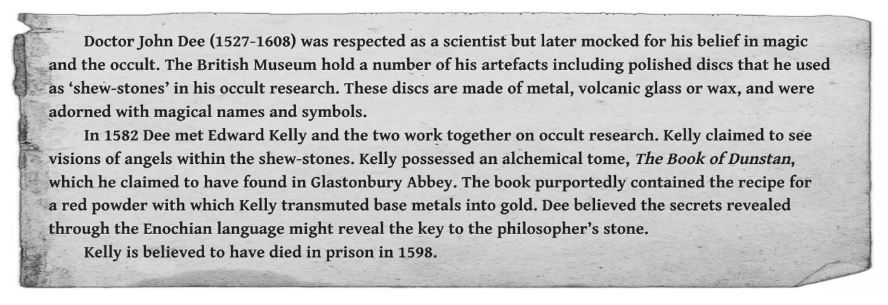
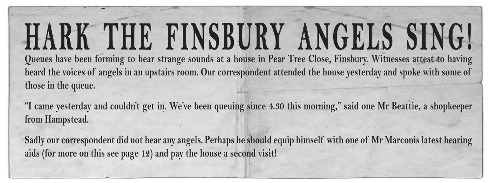

## Раздатки

### Раздатка 1: Эдвард Келли

> **Раздатка «Бедные души, живущие во свете» 1**
>
> Доктора Джона Ди (1527–1608) уважали как учёного, но позже высмеивали за веру в магию и оккультизм. Британский музей хранит ряд его вещей, в том числе полированные диски, которыми он пользовался в оккультных изысканиях как «магическими камнями». Диски сделаны из металла, вулканического стекла или воска и покрыты магическими именами и знаками.
>
> В 1582 году Ди познакомился с Эдвардом Келли, и они вместе занимались оккультными изысканиями. Келли утверждал, что видит в магических камнях ангелов. У Келли был алхимический трактат — «Книга Дунстана», который он, по его словам, нашёл в Гластонберийском аббатстве. В книге якобы был рецепт красного порошка, которым Келли превращал неблагородные металлы в золото. Ди верил, что тайны, открытые через енохианский язык, могут указать ключ к философскому камню.
>
> Считается, что Келли умер в тюрьме в 1598 году.

### Раздатка 2: газетная заметка из «Дейли геральд» от 19 марта 1923 года

> **Раздатка «Бедные души, живущие во свете» 2**
>
> **ВНЕМЛИТЕ: ПОЮТ ФИНСБЕРИЙСКИЕ АНГЕЛЫ!**
>
> У дома на Пэр-Три-Клоуз в Финсбери выстраиваются очереди — люди хотят услышать странные звуки. Свидетели уверяют, что слышали голоса ангелов в комнате наверху. Наш корреспондент побывал у дома вчера и поговорил с некоторыми из тех, кто стоял в очереди.
>
> «Я приходил вчера и не смог попасть внутрь. Мы стоим в очереди с половины пятого утра», — сказал некий мистер Битти, лавочник из Хэмпстеда.
>
> Увы, наш корреспондент никаких ангелов не услышал. Может быть, ему стоит обзавестись новейшим слуховым аппаратом мистера Маркони (подробнее об этом — на двенадцатой странице) и наведаться в дом ещё раз!
