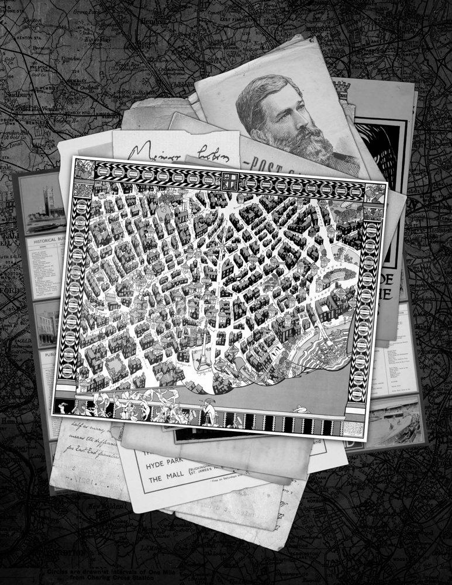

*Полностраничная заставка без текста: ворох бумаг на фоне старой карты Лондона — рисованная карта-панорама театрального Вест-Энда (Стрэнд, Трафальгарская площадь) в рамке из названий театров, гравированный портрет бородатого мужчины, газетные и рекламные листки («Гайд-парк», «Мэлл»), рукописные записки.*
