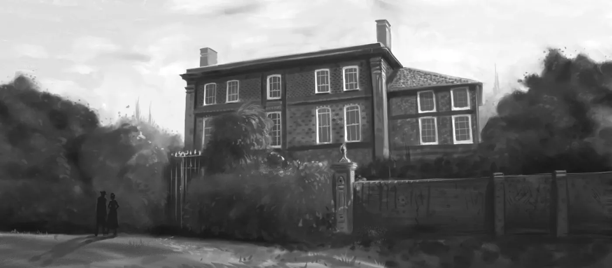

мисс Хэвершем тут же забрать их у неё. Однако та явно не хотела расставаться с рукописями Ди и попросила время подумать над предложением. А на следующий же день в школу вломились и листы похитили.

Леандер считает, что взлом — дело рук какого-то книготорговца-соперника, и хочет, чтобы сыщики нашли воров и вернули листы. Он готов щедро заплатить за возвращение всех семи листов в целости, ведь только так можно наконец завершить один из великих трудов доктора Джона Ди. Полиция, разумеется, разыскивает воров, наделавших в школе переполоха. Однако добыча листов — и их сохранность — для лондонских стражей порядка явно не главная забота.

Грива нетрудно невзлюбить, и вполне возможно, что сыщики не будут ему доверять. Однако ради столь редкой оккультной добычи они могут всё же решить взяться за дело — вернут они в итоге листы Гриву или нет.

Если сыщиков нужно подтолкнуть, дайте им **Раздатку 1** — вырезку из «*Газетт*» о гнусном нападении на школу, полную беззащитных девочек. Когда сыщики решат начать расследование со школы, Леандер отправит мисс Хэвершем телеграмму, предупредит её об их приезде и, будем надеяться, обеспечит им встречу.

## Мортлейкская школа для девочек

Неподалёку от Ботанического сада Кью, на южном берегу Темзы, в районе Ричмонд, лежит утопающий в зелени пригород Мортлейк. Хоть он и в Лондоне, Мортлейк очень похож на маленькую деревню, и история здесь на каждом шагу — от церкви Святой Девы Марии XVI века до трёхсотлетнего паба «Queen’s Head». Сегодня Мортлейк знаменит тремя вещами: здесь финиш лодочной гонки Оксфорд — Кембридж; здесь похоронен сэр Ричард Бёртон, автор перевода «Тысячи и одной ночи»; и здесь жил елизаветинский учёный и чародей доктор Джон Ди. Дом Джона Ди — теперь это Чёрч-стрит, 2, Мортлейк — всё ещё стоит: обветшалый средневековый особняк в плохом состоянии. Часть здания давно снесена, но остальное по-прежнему стоит как центральное крыло дорогой закрытой Мортлейкской школы для девочек. Подробнее о Джоне Ди и его доме — «***The Keeper’s Guide to London***», с. 42.

*Прим. перев.: в оригинале «Arabian Knights» вместо «Arabian Nights».*

В старом крыле более 40 комнат, а также соединяющие их коридоры, чуланы, несколько подвалов, чердаки и чёрные лестницы для прислуги. Полного плана дома так и не составили, и, хотя за века немало учёных добивались доступа в дом и его угодья, все владельцы неизменно держали их в тайне. Девочки шепчутся о потайных ходах за деревянными панелями, о странных звуках по ночам,

