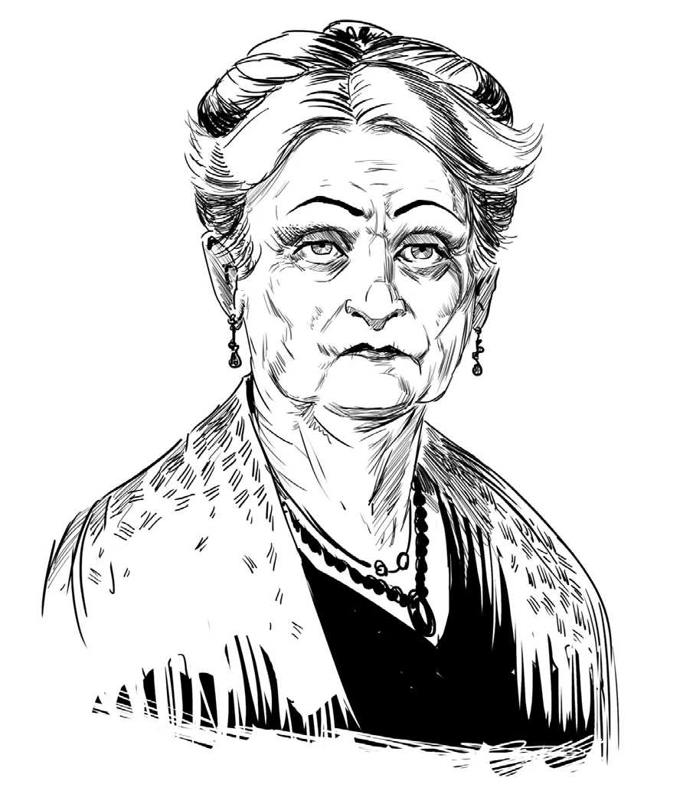

о всевозможных пикантных скандалах, которые, быть может, когда-то разыгрывались за обшитыми деревом стенами дома, но проверить любую из этих историй почти невозможно.

### Встреча с мисс Хэвершем

Вильгельмина Хэвершем — строгая чопорная женщина средних лет, несколько старомодная поборница хороших манер, благородного воспитания и общественных приличий. Она отнюдь не робкого десятка и уж точно не дура: если сыщики думают, что смогут свободно разгуливать по старому особняку доктора Ди и водить её за нос, их ждёт неприятный сюрприз.

Мисс Хэвершем готова иметь дело с частными сыщиками лишь потому, что полицию (и, отчасти, местную прессу) интересует только, кто те громилы, что вломились в её школу. До бумаг Ди им нет ни малейшего дела, а даже если бы и было, они вряд ли знали бы, что искать. Поэтому она сообщит сыщикам всё, что сможет, — пока верит, что им можно доверять.

Однако набивать карманы Леандеру Рэпчеру Гриву мисс Хэвершем тоже не желает. Она просит сыщиков вернуть бумаги — если они их найдут — прямо ей, а не Гриву, и обещает за это вознаграждение. Ей достаточно их слова (хотя, если среди сыщиков есть особенно беспринципные личности, чтобы завоевать её доверие, может понадобиться проверка Красноречия или Убеждения).

Директриса расскажет сыщикам всё, что знает. Листы нашла небольшая компания любопытных девочек, которые среди ночи забрели туда, куда ходить запрещено, и обнаружили в южном подвале потайную нишу. Листы лежали в кожаной папке и явно были спрятаны там намеренно, и довольно давно. Через несколько дней, не зная, к кому ещё обратиться, и отчаянно нуждаясь в свежих средствах для школы, мисс Хэвершем попросила Грива удостоверить находку. Он удостоверил её и сказал, что, возможно, найдёт на бумаги покупателя. Но Грив не знал, что она обратилась ещё к двум известным книготорговцам: к «Уоткинсу» с Чаринг-Кросс и к «Атлантиде» из Блумсбери. Из них некий мистер Киппс, компаньон магазина Уоткинса, заявил, что листы — подделка, а мистер Стэмп из книжного магазина «Атлантида» подтвердил оценку Леандера Грива.

Прошлой ночью, всего через два дня после встречи с книготорговцами, одну из старших девочек разбудил странный шум из южного крыла дома. Несколько девочек встали с постели, чтобы посмотреть, в чём дело, и привлекли внимание учительницы, мисс Хакнелл. Вместе они пошли на шум, решили в конце концов, что он доносится из заброшенной библиотеки, — и до смерти перепугались, когда оттуда выскочили двое здоровяков с шарфами на лицах. Те грубо растолкали девочек, выбежали из дома и умчались с бумагами в чёрном автомобиле.

Мисс Хэвершем спрятала бумаги в старой библиотеке, внутри заплесневелой старой книги, которая, возможно, стояла там ещё со времён самого Ди. Она понятия не имеет, кто мог совершить это преступление и как воры узнали, где спрятаны листы.

Доступ сыщиков в дом будет ограничен: мисс Хэвершем потребует, чтобы их всё время сопровождали, и пустит их только в кабинеты, главный зал, на верхнюю площадку лестницы и в библиотеку. Однако если кому-то из сыщиков удастся ускользнуть или уговорами добиться большего, он обнаружит раскинувшийся дом, построенный многими руками и достраивавшийся веками, где низкие потолки и высокие залы сменяют друг друга до головокружения, куда редко заглядывает дневной свет и где почти невозможно не заблудиться. С домом в Мортлейке что-то очень неладно — он будто заколдован, чтобы никто не нашёл его глубочайших тайн. Говорят, где-то в этом доме есть экземпляр
