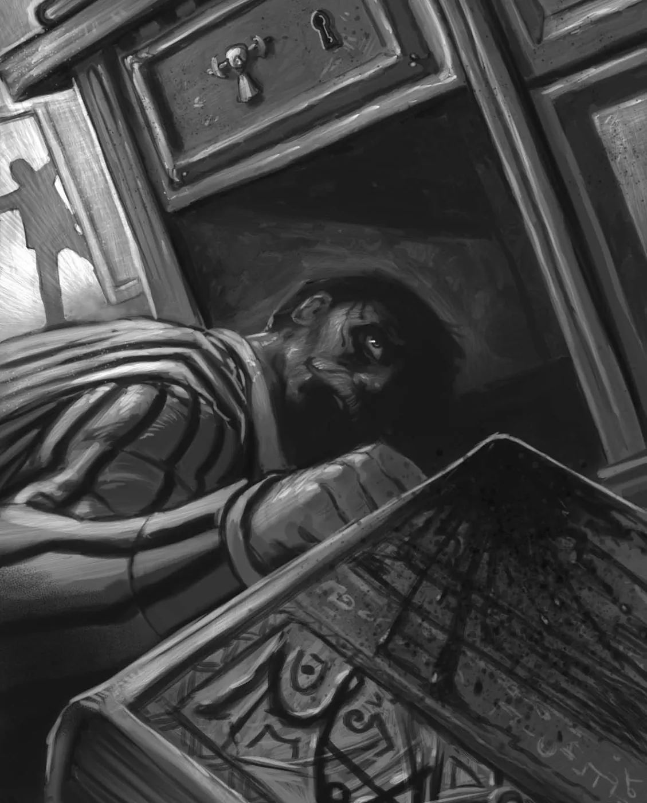

код, заключённый в листах-дубликатах. У Хоутона есть нужные для этого таланты, а прежде всего — глубокое желание самому разгадать тайны Ди; поэтому он поручил мистеру Стэмпу добыть бумаги любыми средствами. Методы Стэмпа его не интересуют, и что именно творится за кулисами, он не знает. Ему известно лишь, что мистер Стэмп сообщил о некой загвоздке, но «дело под контролем», — и этим Хоутон с сыщиками по своей воле уж точно не поделится.

### Торговцы книгами

У ремесла розыска редких рукописей есть своя романтика: книготорговцы выискивают редкие тома в частных собраниях, полуразрушенных монастырях, забытых чердачных библиотеках и запущенных замках по всему свету. Со стороны это похоже на жизнь, полную путешествий и учёных занятий. На деле же лучшие книготорговцы скорее частные сыщики с изрядной примесью коммивояжёра. Большую часть времени они проводят в аукционных залах и на распродажах имущества или выслеживают редкие тома по частным объявлениям. Они всегда готовы невинно солгать, преувеличить ценность книги (или её отсутствие), а то и украсть или сжульничать ради ходкой рукописи, если покровитель заплатит достаточно.

Честные люди в этом ремесле есть, но некоторые — просто мошенники и воры, движимые наживой. Знание книжной торговли у них само собой разумеется, а некоторые даже хорошо разбираются в любимом предмете (как Киппс — в оккультизме); но часто у них есть и знакомые в преступном мире, которые сбудут краденую книгу или с угрозами отвадят других собирателей.

### Рэндольф Киппс

До находки мортлейкских листов Рэндольф Киппс слыл «честным» торговцем — по крайней мере, у своих покровителей. Те, кому довелось испытать на себе его хитрость, вряд ли станут его так хвалить. Киппс завладел бумагами преступным путём; особенно благочестивые сыщики, возможно, захотят потолковать с ним о том, как грубо он обошёлся с мисс Хакнелл в школе. Как и некоторые другие противники в этом приключении, он считал, что сумеет перевести енохианское письмо на листах, и тут же взялся разгадывать смысл загадочного кода. Пока его подручный Майкл Бакстер не показал своё вероломство и

не ударил его по голове старинным экземпляром «*Malleus Maleficarum*», а затем забрал бумаги и отправился искать своего нового нанимателя, Аттикуса Стэмпа.

#### Квартира Киппса

Рэндольф Киппс живёт на облагороженной улице в Пимлико, в двухэтажной квартире над типографией. Арка ведёт в общий двор за домом, где, по-видимому, типография держит свои фургоны для доставки.

Когда сыщики приходят, входная дверь чуть приоткрыта; она распахивается, открывая крутую лестницу наверх, в тёмные, тихие комнаты Киппса. Если сыщики решат осмотреться, они найдут удобную, но мрачноватую квартиру, полную антикварных книг и папок. На нижнем этаже — гостиная, кухня и прихожая; на верхнем — спальня, ванная и кабинет. Есть ещё маленькая комнатка на чердаке, где Киппс, пока идёт сделка, хранит в большом сейфе самые редкие тома. Однако дальше кабинета сыщики вряд ли пройдут: там они находят тело Киппса — он лежит ничком на полу под письменным столом, получив удар по голове, сбросивший его с кожаного кресла (сыщик, не привыкший видеть трупы, должен пройти проверку Рассудка, потеря 0/1).
