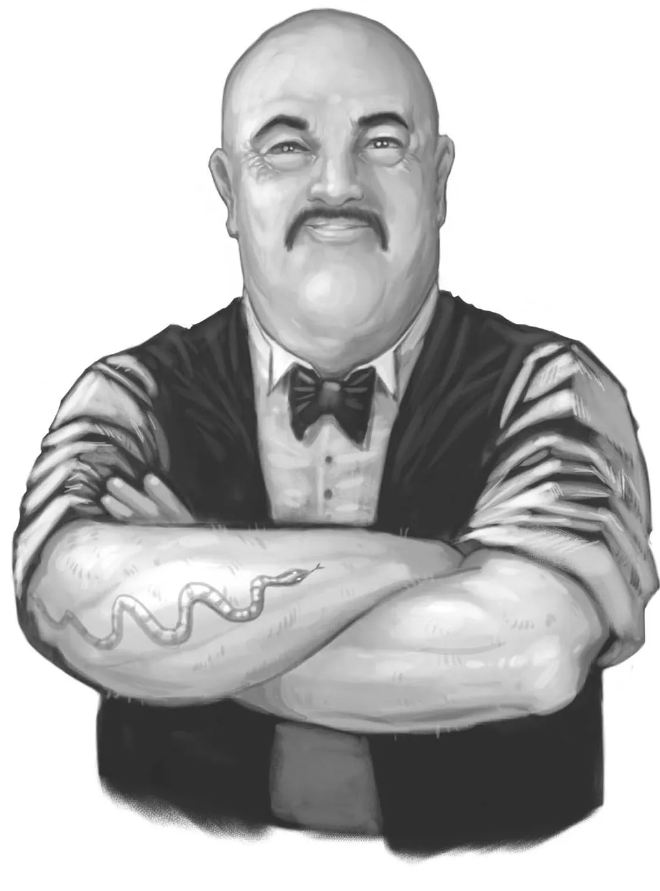

Орудие убийства заметить нетрудно: рядом лежит толстый тяжёлый экземпляр «*Malleus Maleficarum*» — «*Молота ведьм*» — с небольшим пятном крови на потёртом кожаном переплёте (алчные сыщики могут сообразить, что книга довольно ценная, хотя и не самое редкое издание: на открытом рынке за неё дадут около 50–75 фунтов). При Киппсе — бумажник с небольшой суммой денег и несколькими визитными карточками, его собственными и книготорговца мистера Уоткинса. Есть у него и маленький ключ (подходит к ящикам письменного стола).

На столе Киппса лежат несколько книг о трудах Джона Ди, в том числе факсимильное издание *Книги Еноха*. Если сыщики не считают нужным её осмотреть, разрешите проверку Идеи и подскажите, что если они потом найдут мортлейкские листы и захотят перевести их сами, эта книга может дать ключ к шифру Ди. В запертом ящике стола (обычная проверка Взлома или ключ, найденный на теле) лежит драгоценная записная книжка Киппса с адресами. В ней имена и адреса большинства его клиентов за последние десять лет. Почти все записаны стенографией или сокращённо, и чтобы найти самые важные имена — прежде всего Аттикуса Стэмпа и Майкла Бакстера, — понадобится несколько часов изучения и проверка ОБР.

Наконец, в комнатке на чердаке есть кое-какие сокровища — если сыщики достаточно беспринципны, чтобы обокрасть мертвеца. Трудная проверка Взлома позволит открыть сейф; в нём 300 фунтов банкнотами и один или несколько второстепенных томов Мифов на выбор Хранителя.

#### Двор типографии

За квартирой сыщики найдут старый двор с несколькими пристройками, где типография хранит машины и материалы. Там же есть крытый навес для машин, а под ним стоит маленький чёрный фургон с надписью на боку: «Р. Т. Киппс, книготорговец, торговец и знаток антикварных рукописей». Надпись почти целиком замазана чем-то вроде чёрной ваксы.

Во дворе есть пожарная лестница, ведущая к окну ванной Киппса. Если сыщики придут после наступления темноты, это самый надёжный способ проникнуть в дом незамеченными.

#### Перст подозрения

Если сыщики слишком долго копаются в квартире Киппса — особенно если неосторожно или средь бела дня, — велика вероятность, что их увидят и потом сообщат о них полиции. В этом приключении у сыщиков не раз будет возможность пересечься со Скотланд-Ярдом, и если они окажутся замешаны несколько раз, полиции это может показаться слишком подозрительным совпадением. Если беспечных сыщиков притащат в полицейский участок, это вполне может отрезвить их — и сильно задержать расследование.

### Майкл Бакстер

Бакстер — крепко сложённый мужчина, до того как его нанял Рэндольф Киппс, он выступал боксёром. Физически с ним лучше не связываться, но перехитрить его или взять на испуг легко.

Если сыщики найдут адрес Бакстера в Камдене, они застанут его кутящим с девицей из дешёвого ночного клуба, мечтающей стать «флэппер», — он сорит десятью фунтами, полученными за предательство хозяина. Бакстер не понимает, что убил Киппса: он думает, что лишь оглушил его, — он не знает собственной силы. Если выложить ему правду и пригрозить законом, он быстро сдастся и расскажет сыщикам всё, что они хотят знать, в обмен на возможность сбежать с форой. Если же сыщики решат начать переговоры с насилия, недюжинное мастерство Бакстера в кулачном бою может преподать им урок осторожности…
