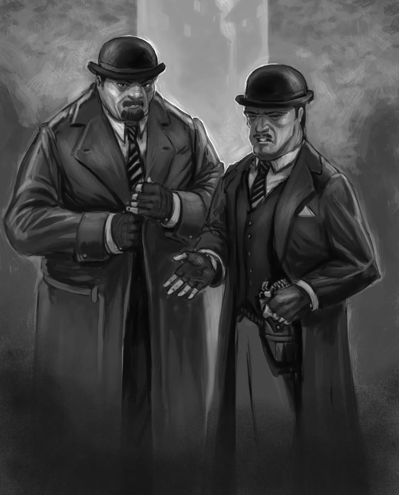

Проверка Внимания позволит найти в потрёпанном дневнике на столе в кабинете наспех нацарапанные енохианские символы. Успешная проверка Работы в библиотеке −20 или Оккультизма поможет разобраться в изысканиях Стэмпа над кодом Ди. По сути, он пытался разгадать тайну енохианского письма и нашёл в трудах Ди упоминание о чём-то под названием «неевклидовы врата», которые Стэмп, очевидно, считает вратами в другое измерение — измерение, которое Ди считал Авалоном, землёй вечного лета и местом за завесой времени, где сам король Артур ждёт дня, когда его призовут обратно в Британию. Переводы енохианских букв Ди, сделанные Стэмпом, беспорядочно разбросаны по всему дневнику; похоже, однако, что Ди намекал, будто «увидит Авалон местом своего последнего упокоения, если ангелы сочтут его достойным следовать их божественным указаниям» (игроки, прошедшие приключение «**Бедные души, живущие во свете**», с. 46, справедливо встревожатся при мысли о том, чтобы слушаться ангелов Ди).

*Прим. перев.: «Library Use −20» — модификатор в стиле 6-й редакции; оставлено как напечатано (в 7-й редакции ему соответствовала бы трудная проверка).*

Стэмп отметил, что у кода в записанном виде девять разных возможных переводов, а значит, в письме должны быть дополнительные знаки, которые помогут его взломать. Он вспомнил, что видел один такой знак на надгробии Ди в церкви в Мортлейке, и связал его с упоминанием о «месте упокоения». Значит, скорее всего, туда он и отправился — обратно в Мортлейк!

### «Золотая заря»

Рано или поздно клиенты мистера Уоткинса из «Золотой зари» лично займутся возвращением мортлейкских листов, и это приведёт как минимум к одной стычке с сыщиками. Члены «Золотой зари» не ведут расследование сами, а нанимают частных агентов, чтобы те шли по следу. В зависимости от того, насколько небрежны или осмотрительны были сыщики, эти агенты могут нагнать их раньше или позже.

Хранителю советуется пустить агентов по тому же следу, что и сыщиков, — быть может, всего на шаг позади. Идеальный момент для встречи агентов «Золотой зари» с группой — когда сыщики выходят из дома Майкла Бакстера. К ним подходят двое суровых мужчин в чёрных котелках и требуют рассказать всё, что сыщики узнали о том, где находятся мортлейкские листы.

Как пройдёт эта встреча — целиком на усмотрение Хранителя. Агенты «Золотой зари» умны и вооружены (см. их профиль на соседней странице). Любезничать им некогда, но они объединят силы с сыщиками, если сочтут, что дело того стоит. Даже если первая встреча пройдёт плохо, но никто серьёзно не пострадает, агенты могут позже появиться снова и предложить денежное вознаграждение за возвращение бумаг: сначала они предложат столько же, сколько предложил Грив, а при необходимости — значительно больше. Разумеется, если сыщики нарочно дадут «Золотой заре» от ворот поворот, это плохо скажется на их будущих делах с этой могущественной оккультной организацией.

Заметьте, что представитель «Золотой зари», распоряжающийся агентами ордена, в этом приключении нарочно не назван. Ввести фигуру из столь важной оккультной организации — большое дело в кампании «*Зова Ктулху*»: сыщики могут обрести могущественного союзника или врага, а Хранитель — постоянного персонажа, к которому можно возвращаться. Поэтому, если Хранитель хочет ввести именитого высокопоставленного члена ордена, делать это нужно осторожно. Из членов ордена 1920-х подойдут Эвелин Андерхилл (христианский богослов), Элджернон Блэквуд (известный романист) или Артур Эдвард Уэйт (оккультист и масон).
