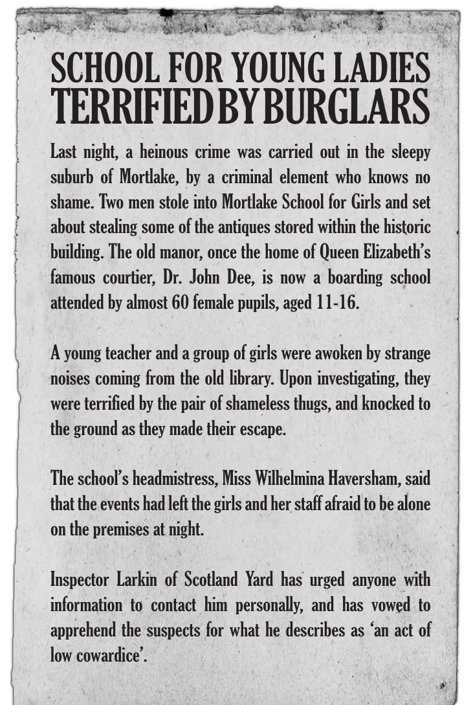

проведения ритуала описаны вместе с этим заклинанием. Сыщики, у которых есть Христаллум из прошлого приключения, получают +10 к проверке на расшифровку кода.
- *Сыщики отдают бумаги одному из претендентов.* По закону бумаги принадлежат мисс Хэвершем, и в конце концов она, скорее всего, продаст их тому, кто больше заплатит, чтобы найти средства для своей бедствующей школы. Если потом бумаги попадут в руки кого-то вроде Алоизиуса Дельгадо, зловещего злодея из «*The Curse of Nineveh*», не нужно быть гением, чтобы понять: может случиться страшное.
- *Сыщики могут решить уничтожить бумаги — они слишком опасны, чтобы ими распоряжался один человек.* Разумный выбор, который сразу даёт награду +1d3 Рассудка. Однако этим сыщики наживут себе врагов в высоких кругах: все — от упомянутых выше книготорговцев до «Золотой зари» — затаят на них обиду.

### Награды и потери

В этом приключении много возможностей и для победы, и для поражения. Выжившие сыщики получают такие награды (или потери) в зависимости от своих поступков:

| Событие | Итог |
|---|---|
| Стэмп проводит ритуал, но его побеждают и врата закрываются. | +1d8 Рассудка |
| Стэмпу не удаётся провести ритуал, и его задерживают. | +1d6 Рассудка, +1d3 Средств |
| Майкла Бакстера сдают полиции. | +1d3 Средств |
| Мисс Хэвершем, мисс Хакнелл или кто-то из школьниц ранены или убиты. | −1d6 Рассудка, −1d3 Средств |
| Сыщика арестовывает полиция во время приключения. | −1d4 Средств |
| Сыщики становятся заклятыми врагами «Золотой зари». | −1d6 Средств |
| Сыщики становятся заклятыми врагами Грива, Хоутона, Уоткинса — кого-то одного или нескольких. | −1d3 Средств |

## Раздатки

**Раздатка 1:** вырезка из «Ивнинг газетт»

> **Раздатка 1: вырезка из «Ивнинг газетт»**
>
> **ВЗЛОМЩИКИ НАПУГАЛИ ШКОЛУ ДЛЯ ЮНЫХ ЛЕДИ**
>
> Прошлой ночью в сонном пригороде Мортлейке преступный элемент, не знающий стыда, совершил гнусное преступление. Двое мужчин прокрались в Мортлейкскую школу для девочек и принялись красть кое-что из старинных вещей, хранящихся в этом историческом здании. Старинный особняк, некогда дом знаменитого придворного королевы Елизаветы доктора Джона Ди, ныне — школа-пансион, где учатся почти 60 девочек в возрасте 11–16 лет.
>
> Молодую учительницу и группу девочек разбудил странный шум из старой библиотеки. Пойдя проверить, в чём дело, они до смерти перепугались пары бесстыжих громил, которые, убегая, сбили их с ног.
>
> Директриса школы мисс Вильгельмина Хэвершем заявила, что после этих событий девочки и персонал боятся оставаться ночью в здании одни.
>
> Инспектор Ларкин из Скотланд-Ярда призвал всех, кто располагает сведениями, обращаться лично к нему и поклялся задержать подозреваемых в том, что он называет «актом низкой трусости».
