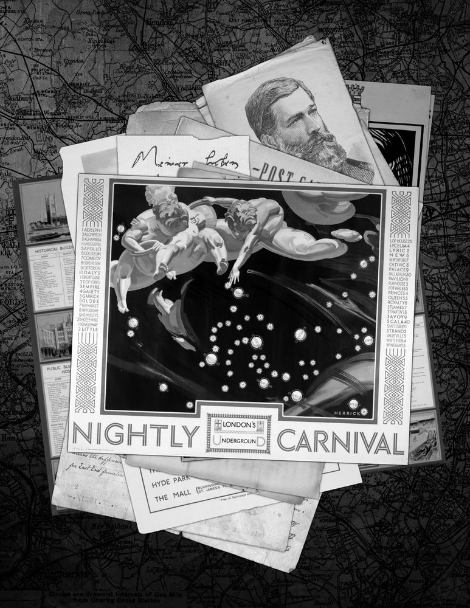

*Полностраничный коллаж без текста: на старой карте Лондона — стопка бумаг, гравированный портрет бородатого мужчины, путеводитель по историческим зданиям и плакат лондонского метро «Nightly Carnival» («Ночной карнавал»: ангелы рассыпают звёзды над списком театров Вест-Энда).*
