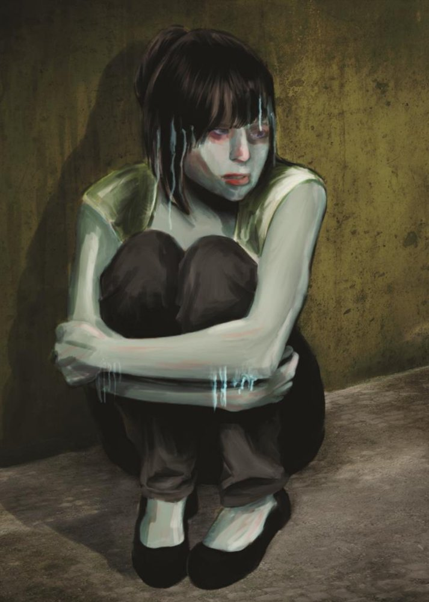

НАСЛЕДИЕ ПИКМАНА

Киган Салливан

*На обложке — рисунок Марко Монте (Marco Monte): бледная темноволосая девушка сидит на полу у стены, обхватив колени; пальцы у неё будто с когтями. Над рисунком — название «Pickman’s Legacy», внизу — логотип «Call of Cthulhu — Miskatonic Repository».*
