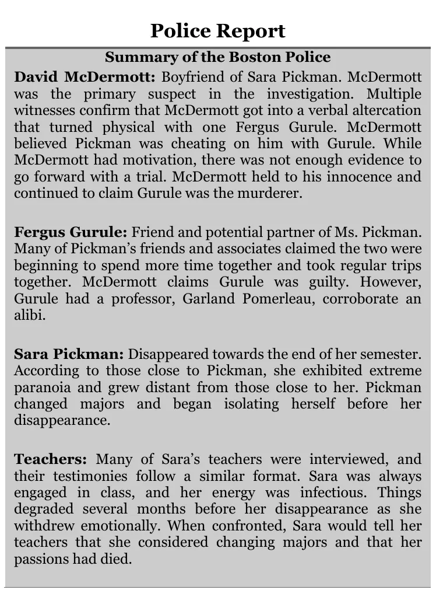
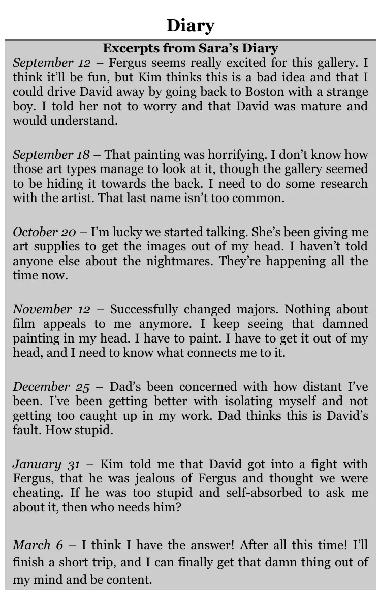

# Раздатка

*Ниже — каждая раздатка в оригинале (картинкой, для печати) и её перевод.*

## Полицейский отчёт

> **Раздатка: Полицейский отчёт**
>
> **Сводка бостонской полиции**
>
> **Дэвид Макдермотт:** парень Сары Пикман. Макдермотт был главным подозреваемым по делу. Несколько свидетелей подтверждают, что словесная перепалка Макдермотта с неким Фергусом Гуруле переросла в драку. Макдермотт считал, что Пикман изменяет ему с Гуруле. Хотя мотив у Макдермотта был, улик для передачи дела в суд не хватило. Макдермотт настаивал на своей невиновности и продолжал утверждать, что убийца — Гуруле.
>
> **Фергус Гуруле:** друг и, возможно, партнёр мисс Пикман. Многие друзья и знакомые Пикман утверждали, что эти двое стали проводить больше времени вместе и регулярно куда-то ездили вдвоём. Макдермотт утверждает, что виновен Гуруле. Однако алиби Гуруле подтвердил преподаватель — Гарланд Померло.
>
> **Сара Пикман:** пропала ближе к концу семестра. По словам близких, проявляла крайнюю паранойю и отдалилась от близких ей людей. Перед исчезновением Пикман сменила специальность и стала замыкаться в себе.
>
> **Преподаватели:** допрошены многие преподаватели Сары; их показания схожи. Сара всегда была увлечена занятиями, её энергия заражала. За несколько месяцев до исчезновения всё стало хуже: она эмоционально замкнулась. Когда её об этом спрашивали, Сара говорила преподавателям, что подумывает сменить специальность и что её увлечения угасли.

## Дневник Сары

> **Раздатка: Дневник Сары**
>
> **Отрывки из дневника Сары**
>
> *12 сентября* — Фергус, кажется, в восторге от этой галереи. Думаю, будет весело, но Ким считает, что это плохая идея и что я могу оттолкнуть Дэвида, если снова поеду в Бостон с каким-то странным парнем. Я сказала ей не волноваться: Дэвид взрослый и всё поймёт.
>
> *18 сентября* — Та картина была ужасна. Не понимаю, как эти люди искусства могут на неё смотреть, хотя галерея, кажется, прятала её в глубине зала. Надо разузнать о художнике. Фамилия у него не такая уж частая.
>
> *20 октября* — Как мне повезло, что мы начали общаться. Она даёт мне художественные принадлежности, чтобы я выплеснула образы из головы. Я больше никому не рассказывала о кошмарах. Теперь они снятся всё время.
>
> *12 ноября* — Сменила специальность. В кино меня больше ничего не привлекает. Мне всё видится та проклятая картина. Мне надо писать. Надо выплеснуть её из головы, и мне нужно знать, что меня с ней связывает.
>
> *25 декабря* — Папа беспокоится, что я так отдалилась. У меня всё лучше получается держаться особняком и не слишком увлекаться работой. Папа думает, что это вина Дэвида. Как глупо.
>
> *31 января* — Ким сказала, что Дэвид подрался с Фергусом: он ревновал к Фергусу и думал, что мы ему изменяем. Если он слишком глуп и самовлюблён, чтобы спросить меня самому, то кому он нужен?
>
> *6 марта* — Кажется, я нашла ответ! После стольких месяцев! Съезжу ненадолго — и наконец выброшу эту чёртову штуку из головы и успокоюсь.
