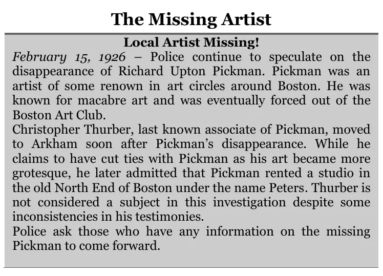
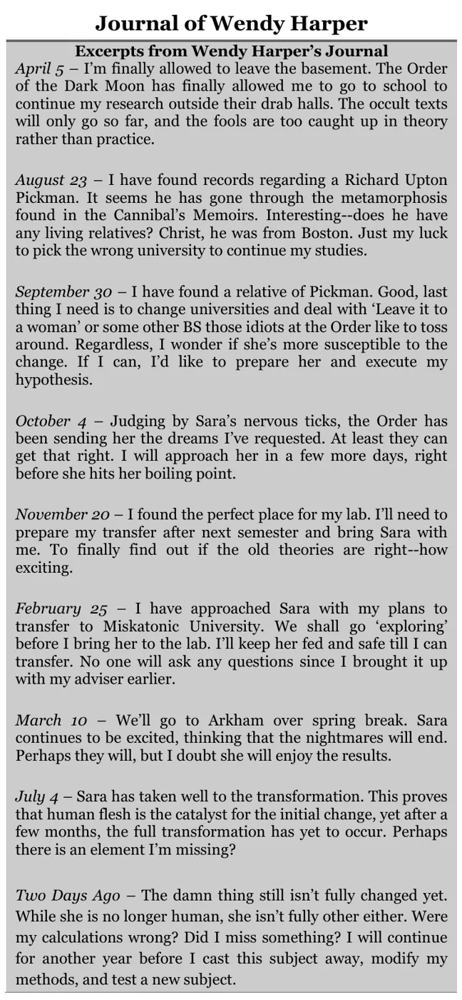

## Пропавший художник

> **Раздатка: Пропавший художник**
>
> **Пропал местный художник!**
>
> *15 февраля 1926 года* — Полиция продолжает строить догадки об исчезновении Ричарда Аптона Пикмана. Пикман был художником с некоторой известностью в художественных кругах Бостона. Он был известен своим жутким искусством и в конце концов был вынужден покинуть Бостонский художественный клуб.
>
> Кристофер Тёрбер, последний известный знакомый Пикмана, переехал в Аркхэм вскоре после исчезновения Пикмана. Он утверждает, что порвал с Пикманом, когда искусство того стало слишком гротескным, однако позже признал, что Пикман снимал студию в старом Норт-Энде Бостона под именем Питерс. Тёрбер не считается фигурантом этого дела, несмотря на некоторые несоответствия в его показаниях.
>
> Полиция просит всех, у кого есть какие-либо сведения о пропавшем Пикмане, обратиться в полицию.

## Журнал Венди Харпер

> **Раздатка: Журнал Венди Харпер**
>
> **Отрывки из журнала Венди Харпер**
>
> *5 апреля* — Наконец-то мне позволили покинуть подвал. Орден Тёмной Луны наконец разрешил мне пойти учиться и продолжить исследования вне их унылых залов. Оккультные тексты заведут лишь до какого-то предела, а эти глупцы слишком увлечены теорией вместо практики.
>
> *23 августа* — Я нашла записи о некоем Ричарде Аптоне Пикмане. Похоже, он прошёл метаморфозу, описанную в «Мемуарах каннибала». Любопытно — есть ли у него живые родственники? Господи, он был из Бостона. Надо же было мне так не угадать с университетом для продолжения учёбы.
>
> *30 сентября* — Я нашла родственницу Пикмана. Хорошо: меньше всего мне нужно менять университет и терпеть «Чего ещё ждать от женщины» или другую чушь, которой любят бросаться эти идиоты из Ордена. Так или иначе, интересно, не восприимчивее ли она к изменению. Если получится, я хотела бы подготовить её и проверить свою гипотезу.
>
> *4 октября* — Судя по нервным тикам Сары, Орден насылает ей сны, о которых я просила. Хоть это они могут сделать как следует. Подойду к ней через несколько дней — прямо перед тем, как она дойдёт до точки кипения.
>
> *20 ноября* — Я нашла идеальное место для лаборатории. Нужно подготовить перевод после следующего семестра и взять Сару с собой. Наконец узнать, верны ли старые теории, — как волнующе.
>
> *25 февраля* — Я рассказала Саре о своих планах перевестись в Мискатоникский университет. Мы отправимся «на разведку», прежде чем я приведу её в лабораторию. Буду кормить её и беречь, пока не переведусь. Никто не задаст вопросов — я заранее обсудила это с научным руководителем.
>
> *10 марта* — Поедем в Аркхэм на весенних каникулах. Сара всё так же взволнована: думает, что кошмары закончатся. Может, и закончатся, но вряд ли ей понравится результат.
>
> *4 июля* — Сара хорошо переносит превращение. Это доказывает, что катализатор первичного изменения — человеческая плоть, однако за несколько месяцев полное превращение так и не произошло. Может, я упускаю какой-то элемент?
>
> *Два дня назад* — Чёртова тварь до сих пор не изменилась полностью. Она уже не человек, но и не вполне иное существо. Неужели мои расчёты неверны? Я что-то упустила? Продолжу ещё год, а потом брошу этот объект, изменю методы и испытаю новый.
