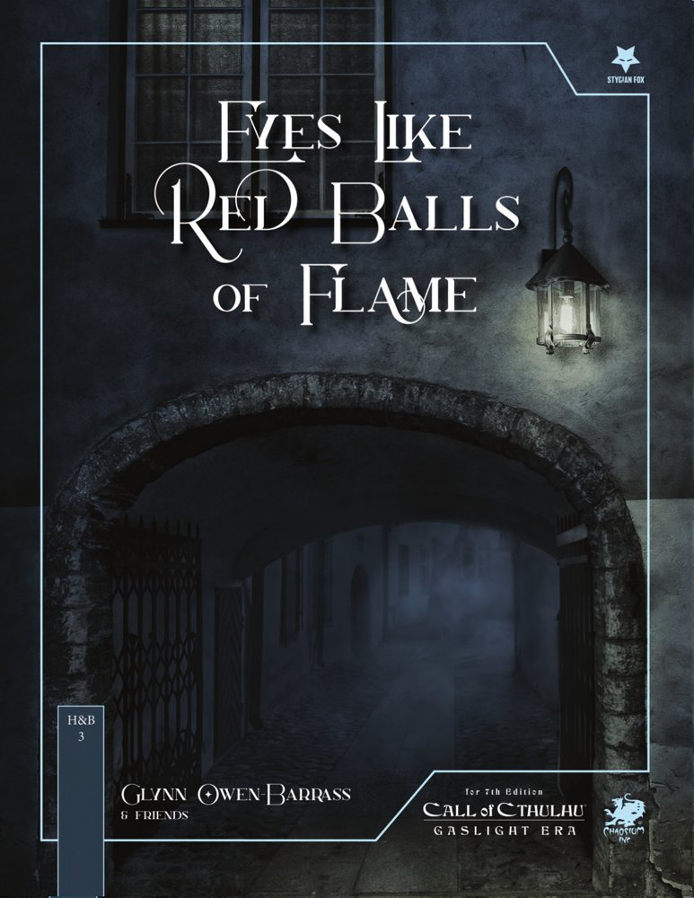

ГЛАЗА КАК КРАСНЫЕ ОГНЕННЫЕ ШАРЫ

Глинн Оуэн Баррас и друзья

*На обложке — ночная мощёная улица: каменная арка с распахнутыми коваными воротами, за ней туманный переулок, на стене — горящий фонарь. Вверху справа — логотип Stygian Fox; внизу — имя автора (Glynn Owen-Barrass & friends — «Глинн Оуэн-Баррас и друзья»), надпись «for 7th Edition Call of Cthulhu — Gaslight Era» («для 7-й редакции „Зова Ктулху“ — эпоха „Газового света“») и логотип Chaosium; на корешковой плашке слева — «H&B 3» (серия «Хадсон и Брэнд», выпуск 3).*
