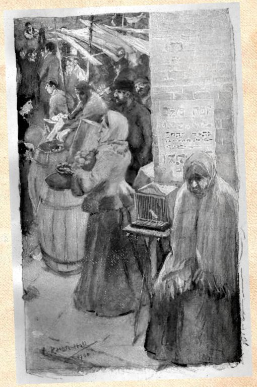

# Выходные данные

*Старинная гравюра: толпа у прилавков лондонского уличного рынка; на переднем плане — старуха в платке, рядом с ней на подставке — клетка с птицей, за ней на стене — вывеска с надписью на иврите.*

***Хадсон и Брэнд: Глаза как красные огненные шары*** (*Hudson & Brand: Eyes Like Red Balls of Flame*)

© 2019 Stygian Fox. Все права защищены.

Отрывки из издания, а также связанные с ним реклама и иллюстрации, созданные для *«Хадсон и Брэнд: Глаза как красные огненные шары»*, остаются собственностью художников, и авторские права на них принадлежат им. Воспроизведение материалов этой книги с целью личной или коммерческой выгоды любыми средствами запрещено.

Воспроизведение материалов этой книги с целью личной или коммерческой выгоды любыми средствами запрещено. Любое сходство персонажей этой книги с существами живыми, мёртвыми или как-то иначе не вполне нормальными совершенно случайно.

Call of Cthulhu («Зов Ктулху»), Chaosium Inc. и логотип Chaosium — зарегистрированные товарные знаки Chaosium Inc., используются с разрешения. *Call of Cthulhu* © 1981–2020 Chaosium Inc. Используется с разрешения. (chaosium.com) www.chaosium.com

Пишите нам на страницу в Facebook: facebook.com/StygianFoxPublishing/

Издатель — Stygian Fox, Честер, Великобритания. stygianfox.com. Напечатано на Земле.

*Прим. перев.: так в оригинале — фраза о запрете воспроизведения повторена дважды.*
