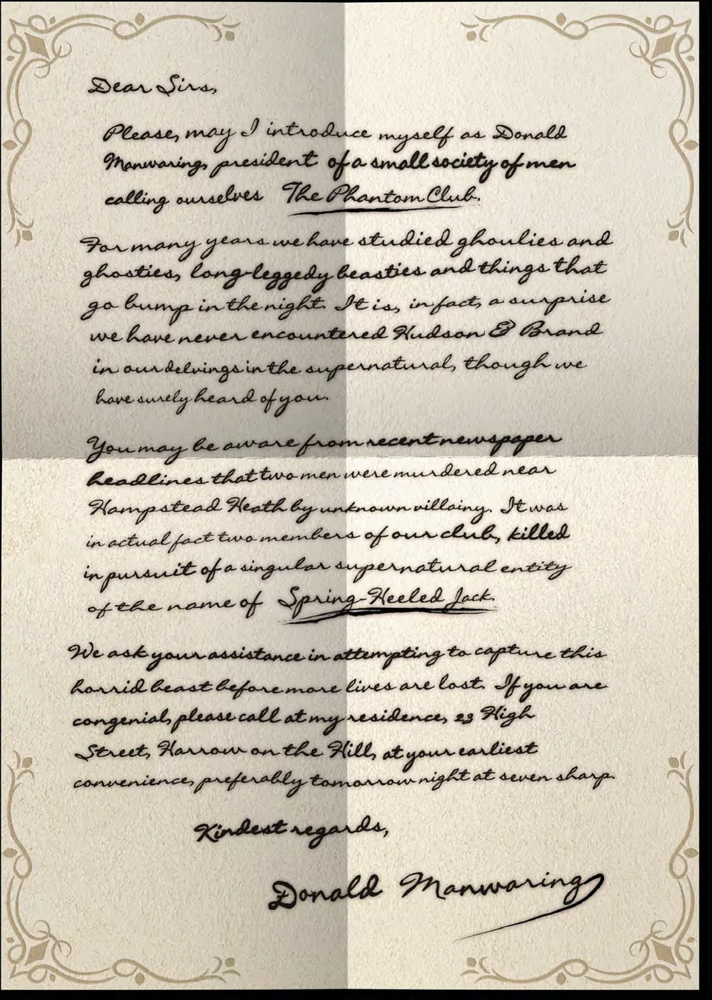

> **Раздатка 1**
>
> *Письмо от руки, на сложенном вчетверо листе с узорной рамкой.*
>
> Уважаемые господа!
>
> Позвольте представиться: Дональд Мэнуоринг, президент небольшого общества джентльменов, именующих себя Призрачным клубом.
>
> Много лет мы изучаем вурдалаков и привидений, длинноногих тварей и всё, что бродит в ночи. По правде говоря, удивительно, что в наших изысканиях в области сверхъестественного мы ни разу не встречались с «Хадсоном и Брэндом», хотя, разумеется, наслышаны о вас.
>
> Возможно, из недавних газетных заголовков вам известно, что близ Хэмпстед-Хита неизвестные злодейски убили двух человек. На самом деле это были два члена нашего клуба, погибшие в погоне за необычайным сверхъестественным существом по имени Джек-Прыгун.
>
> Мы просим вас помочь поймать эту ужасную тварь, пока не погибли новые люди. Если вы согласны, прошу посетить меня по адресу: Хай-стрит, 23, Харроу-он-те-Хилл — в любое удобное время, лучше всего завтра вечером ровно в семь.
>
> С наилучшими пожеланиями,
>
> *Дональд Мэнуоринг*
