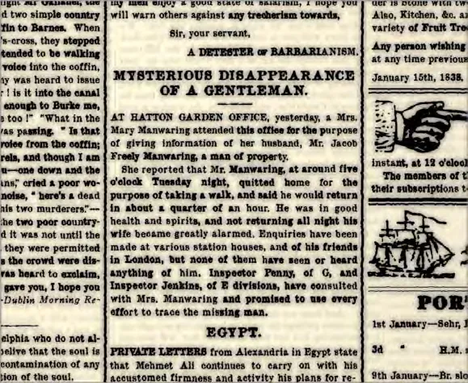

Финнеган и Гарджери, сейчас в отъезде: на северо-востоке они расследуют легенду о Призраке Хай-Грин. Затем он объясняет, что Призрачный клуб основал в 1835 году его дед, чтобы изучать сверхъестественных существ, их повадки и происхождение и распространять знания о них. Дальше он рассказывает, что две недели назад клуб едва не поймал Джека-Прыгуна близ Хэмпстед-Хита, но злодей зверски убил двух членов клуба — Бернарда Уотерса и Хантера Данна. Клуб совершенно уверен, что Джек скрывается где-то рядом с Хэмпстед-Хитом или на самой пустоши. Не поделятся ли сыщики своим опытом, чтобы помочь задержать существо, пока жертв не стало больше? Джек-Прыгун взял над ними верх, и если сыщики помогут, их щедро вознаградят.

Если сыщики спросят, может ли клуб поделиться сведениями о Джеке-Прыгуне, Мэнуоринг кивнёт Годфри, и тот достанет из кармана запечатанный сургучом конверт. Сыщики могут вскрыть его сразу или позже.

Мэнуоринг объясняет, что с тех пор, как Джек появился снова, его видели в основном в окрестностях Хэмпстед-Хита. Он хотел бы начать охоту следующей ночью, в пятницу, если сыщики согласны. Если нет — в любую ночь, когда они свободны. Он просит встретиться в 11 вечера на Уиллоуби-роуд, неподалёку от места, где убили его друзей.

*Прим. перев.: запечатанный конверт — это, по всей видимости, «Дело Джека» (раздатка 2a–2b, с. 7–8).*

# Изыскания и охота

## Изыскания

Если сыщики ищут сведения в газетах, о самом Призрачном клубе они ничего не найдут, зато найдут сведения о его членах.

Одна газетная заметка — об основателе клуба Джейкобе Фрили Мэнуоринге. Другая подробно рассказывает о погибших членах клуба; есть и заметка о Дональде Мэнуоринге, его жене и детях. Если сыщики ищут сведения о Джеке-Прыгуне и ещё не получили записку от клуба, дайте им любые сведения из *раздатки 2a* и *2b* в виде газетных заметок, а уровень сложности проверок назначьте на своё усмотрение.

Газетные заметки, приведённые ниже, можно найти в библиотеке (проверка навыка **Работа в библиотеке**) или в редакции газеты (проверка навыка **Журналистика**). Для *раздатки 3* из-за давности заметки понадобится **чрезвычайная** проверка навыка.

Сыщикам может пригодиться Газетная справочная на Голден-сквер, 33 (см. *Hudson & Brand: Inquiry Agents of the Obscure*, с. 49). При успешной проверке **Удачи** газета с *раздаткой 5* окажется там, а чтобы найти её, нужна успешная проверка навыка **Работа в библиотеке**.
## Охота

Прибыв на Уиллоуби-роуд к 11 вечера, сыщики застают там пятерых мужчин в тяжёлых пальто, скрывающих оружие. Это трое членов клуба, дворецкий Рагхубир и новичок. Его представляют как Петерсона — это крепкий небритый человек в котелке. Если отвести кого-нибудь из членов клуба в сторону, тот объяснит, что Петерсон — преступник: клуб уже нанимал его, когда требовалось применить силу. Кроме того, он прекрасно знает окрестности пустоши.

Когда все в сборе, их делят на две команды. В одну входят Мэнуоринг, Рагхубир и Ходжес, в другую — Годфри и Петерсон. Пусть сыщики присоединятся к какой захотят группе, разделившись как можно поровну. Мэнуоринг сообщает сыщикам, что по району бродят три приманки — тёртые женщины из низов, при каждой свисток и нож. Если появится Джек, они должны засвистеть, чтобы привлечь внимание групп. Затем команды расходятся в разные стороны, и охота начинается всерьёз.

В этот ночной час улицы почти пусты, недавний снег укрыл всё белым покрывалом. Хранителю стоит отмечать на карте, где кто находится.

За каждые полчаса прогулки по улицам пусть сыщик с наименьшей **Удачей** в каждой команде проходит проверку. При провале команда встречает патрульного полицейского (или Хранитель может бросить кубики по таблице «Зловещие предзнаменования» из *The Spirits of London*, с. 12). Полицейский отнесётся к команде с подозрением (ведь в одной из них иностранец, в другой — человек, похожий на преступника). Нужна успешная проверка **Юриспруденции**, **Обаяния**, **Красноречия** или **Убеждения**, иначе он попросит их пройти с ним в участок. Если та же команда встретит его снова, во второй раз понадобится трудная проверка, а после этого — чрезвычайная.

Хранитель может разрешить сыщику трудную проверку **Идеи**. При успехе сыщик может сказать полицейскому, что знаком с суперинтендантом Рональдом Хукером или сержантом Уильямом Парлоу (см. «Populating London» в книге-приложении *Hudson & Brand: Inquiry Agents of the Obscure*, с. 79). После этого больше никаких неприятностей не будет.

> **Раздатка 3**
>
> **ТАИНСТВЕННОЕ ИСЧЕЗНОВЕНИЕ ДЖЕНТЛЬМЕНА.**
>
> В КОНТОРУ ХАТТОН-ГАРДЕН вчера обратилась некая миссис Мэри Мэнуоринг, чтобы сообщить о своём муже, мистере Джейкобе Фрили Мэнуоринге, человеке со средствами.
>
> Она сообщила, что мистер Мэнуоринг около пяти часов вечера во вторник вышел из дома прогуляться и сказал, что вернётся примерно через четверть часа. Он был здоров и в хорошем расположении духа, и когда он не вернулся до утра, жена сильно встревожилась. Справки наводили в различных полицейских участках и у его друзей в Лондоне, но никто из них его не видел и ничего о нём не слышал. Инспектор Пенни из дивизиона G и инспектор Дженкинс из дивизиона E побеседовали с миссис Мэнуоринг и обещали приложить все усилия, чтобы найти пропавшего.

*По краям вырезки — обрывки соседних колонок газеты: конец письма за подписью «Ненавистник варварства» («Сэр, ваш слуга… предостерегите других от всякого вероломства»), начало заметки «Египет» (частные письма из Александрии о планах Мехмета Али), объявления о продаже и дата «15 января 1838 г.»*
