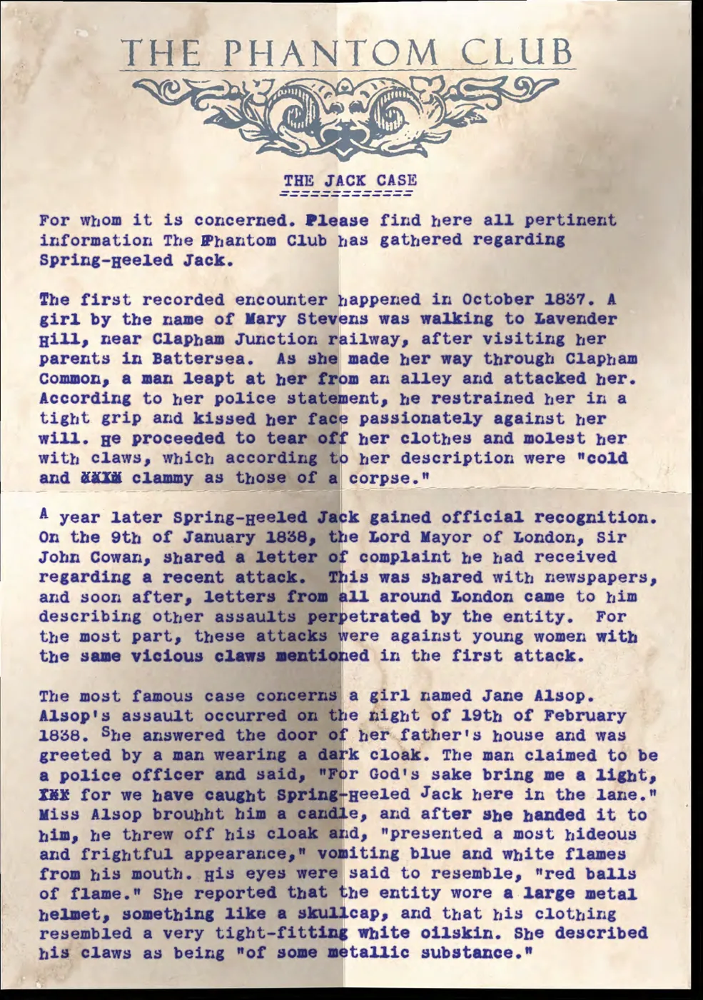

> **Раздатка 2a**
>
> *Машинопись на сложенном листе с узорной виньеткой.*
>
> **ПРИЗРАЧНЫЙ КЛУБ**
>
> **ДЕЛО ДЖЕКА**
>
> Всем, кого это касается. Здесь собраны все сведения о Джеке-Прыгуне, которые удалось собрать Призрачному клубу.
>
> Первая записанная встреча произошла в октябре 1837 года. Девушка по имени Мэри Стивенс, навестив родителей в Баттерси, шла к Лавендер-Хилл, недалеко от железнодорожного узла Клапам-Джанкшен. Когда она шла через Клапам-Коммон, из переулка на неё прыгнул мужчина и напал. По её показаниям в полиции, он крепко схватил её и против её воли страстно целовал ей лицо. Затем он стал срывать с неё одежду и домогаться её, пуская в ход когти, которые, по её описанию, были «холодными и липкими, как у мертвеца».
>
> Через год Джек-Прыгун получил официальное признание. 9 января 1838 года лорд-мэр Лондона сэр Джон Коуэн обнародовал полученное им письмо с жалобой на недавнее нападение. Письмо попало в газеты, и вскоре со всего Лондона к нему пошли письма с описаниями других нападений существа. Большей частью это были нападения на молодых женщин — с теми же жестокими когтями, что и при первом нападении.
>
> Самый известный случай связан с девушкой по имени Джейн Олсоп. Нападение на неё случилось ночью 19 февраля 1838 года. Она открыла дверь отцовского дома, и её встретил мужчина в тёмном плаще. Он назвался полицейским и сказал: «Ради бога, принесите мне огня: мы поймали Джека-Прыгуна здесь, в переулке». Мисс Олсоп принесла ему свечу, а когда отдала её, он сбросил плащ и «явил самый отвратительный и устрашающий облик», изрыгая изо рта сине-белое пламя. Его глаза, по её словам, походили на «красные огненные шары». Она сообщила, что на существе был большой металлический шлем вроде шапочки, а одежда походила на очень облегающую белую промасленную ткань. Его когти, по её описанию, были «из какого-то металла».

*Прим. перев.: в машинописи оригинала есть забитые буквы («XXXX») и опечатка «brouhht» вместо «brought» («принесла»); в переводе они опущены.*
