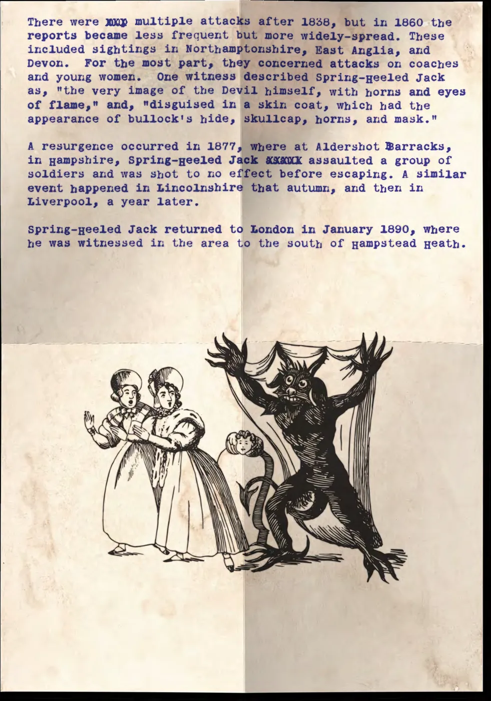

# Ловушка и Хэмпстед-Хит

> **Раздатка 2b**
>
> После 1838 года нападений было много, но с 1860 года сообщения стали реже, зато географически шире. Его видели в Нортгемптоншире, Восточной Англии и Девоне. Большей частью речь шла о нападениях на кареты и молодых женщин. Один свидетель описал Джека-Прыгуна как «точное подобие самого Дьявола, с рогами и огненными глазами», «переодетого в кожаную куртку, похожую на бычью шкуру, в шапочке, с рогами и в маске».
>
> Новая волна случилась в 1877 году: в Олдершотских казармах в Гэмпшире Джек-Прыгун напал на группу солдат, в него стреляли без всякого толку, и он скрылся. Похожее случилось той же осенью в Линкольншире, а через год — в Ливерпуле.
>
> Джек-Прыгун вернулся в Лондон в январе 1890 года: его видели в районе к югу от Хэмпстед-Хита.
>
> *[Под текстом — старинная гравюра: рогатый когтистый дьявол в плаще пугает двух дам в чепцах.]*

*Прим. перев.: и здесь в машинописи есть забитые буквы («XXX», «XXXXX»); в переводе опущены.*
